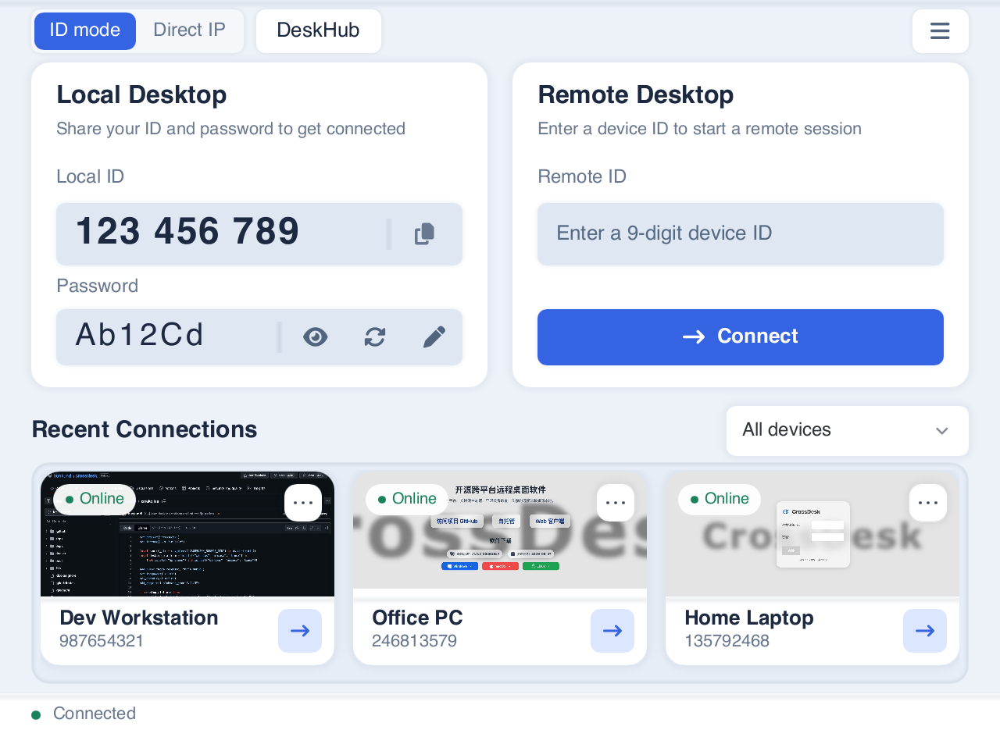
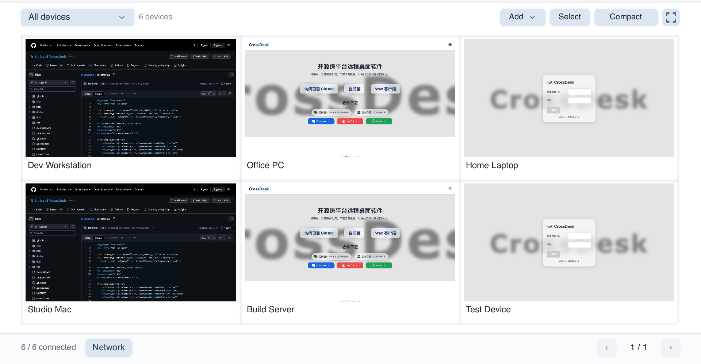

<div align="center">
  
  <h1>CrossDesk</h1>
  <p>A lightweight, cross-platform remote desktop for computers, browsers, and mobile devices, with DeskHub for viewing and controlling multiple desktops.</p>
  <p><a href="https://www.crossdesk.cn/">Website</a> · <a href="https://github.com/kunkundi/crossdesk/releases">Download</a> · <a href="https://web.crossdesk.cn/">Open Web Client</a> · <a href="README.md">中文</a></p>
</div>

<div align="center">

[](#download)
[](https://github.com/kunkundi/crossdesk/releases)
[](https://github.com/kunkundi/crossdesk/actions/workflows/build.yml)
[](LICENSE)
[](https://github.com/kunkundi/crossdesk/stargazers)
[](#sponsor)

</div>

CrossDesk connects Windows, macOS, Linux, and **HarmonyOS PCs**, with browser and native iOS / Android / HarmonyOS phone and tablet clients for controlling computers. The HarmonyOS PC and mobile clients are development builds; see [HarmonyOS support](#harmonyos) for requirements. The desktop client includes **DeskHub**, a separate window for viewing multiple remote desktops, organizing devices into groups, and performing batch actions or synchronized control. Built on [MiniRTC](https://github.com/kunkundi/minirtc), it supports real-time video and audio, keyboard and mouse control, file transfer, and self-hosting. The project is under active development.

> This guide follows the current repository source. Desktop screenshots render the current Slint UI with sample IDs, passwords, online statuses, and recent devices; thumbnails show public pages. Check each release's notes for the features and requirements of its binaries. Native iOS build and signing instructions are below.

[Preview](#preview) · [Download](#download) · [Quick start](#quick-start) · [DeskHub](#deskhub) · [Session controls](#session) · [Settings](#settings) · [iOS](#ios) · [HarmonyOS](#harmonyos) · [Self-hosting](#self-hosting) · [Build](docs/BUILD_EN.md) · [FAQ](docs/FAQ.md#english)

<a id="preview"></a>

## Preview

### Desktop client

The main window presents your credentials and connection controls in Local Desktop and Remote Desktop cards, with recent devices and a group filter below. Open DeskHub at the top left, or use the top-right menu for settings, messages, and About.

<p align="center">
  
</p>

### DeskHub

View multiple devices in a separate window with groups, a resizable grid, compact and fullscreen views, and batch actions. Click a preview to enlarge it, then take control when needed.

<p align="center">
  
</p>

### Web client

Enter a remote device ID and password in your browser without installing the desktop app on the controlling device.

<p align="center">
  
</p>

See the [screenshot notes](docs/images/README.md) for image sources and refresh instructions.

## Features

| Capability | Current support |
| --- | --- |
| Cross-platform control | Windows / macOS / Linux / HarmonyOS PC desktop control; browser and native iOS / Android / HarmonyOS phone and tablet controllers; HarmonyOS clients are development builds |
| Live video and audio | H.264 / AV1, hardware codecs, and remote audio; adjust quality, 30 / 60 fps, and video preference during a session |
| Devices and displays | Recent connections, device aliases and group filtering, session tabs, and remote display switching |
| DeskHub | Live multi-desktop previews, groups and drag reordering, enlarged views with control, synchronized input, and batch connection / disconnection / audio / file actions; configurable resolution, frame rate, and shared video budget |
| Input and sharing | Keyboard/mouse input, remote cursor synchronization, shortcuts, text clipboard synchronization, and file transfer |
| Networking and deployment | Direct P2P connections, TURN relay and forced relay, SRTP media encryption, and self-hosted signaling/relay services |
| Privacy screen | Enable automatically when connected to, or toggle from the session toolbar; availability depends on the host OS and capture method |
| Windows protected desktops | CrossDesk Service forwards input on lock screens, sign-in screens, and secure desktops |
| Linux headless operation | Reuse existing desktops and applications or create separate Xvfb desktops; use the terminal console to check status and change passwords or settings; see [setup](docs/HEADLESS_EN.md) |

Controls and capabilities vary by client. Desktop controls are described below; see the [iOS](apps/ios/README.md), [Android](apps/android/README.md), and [HarmonyOS](apps/harmony/README.md) guides for native mobile features.

<a id="download"></a>

## Download and install

Choose a package matching your OS and CPU architecture from [GitHub Releases](https://github.com/kunkundi/crossdesk/releases) or the [website](https://www.crossdesk.cn/).

| Platform | Current source / CI baseline | Installation |
| --- | --- | --- |
| Windows | Windows 10+, x64 | `.exe` installer; portable builds are also supported |
| macOS | macOS 14.0+, Intel / Apple Silicon | x64 or arm64 `.pkg` |
| Linux | Ubuntu 20.04+, amd64 / arm64, glibc 2.31 baseline | Standard / Xfce virtual desktop `.deb` |
| iOS / iPadOS | iOS 16.0+, arm64 physical device | Native controller; build and sign with Xcode, or sign the unsigned CI app |
| Android | Android 8.0+, arm64 | Native controller; build an APK with Gradle ([guide](apps/android/README.md)) |
| HarmonyOS (development) | PC: API 26; phones / tablets: API 20+; arm64, physical-device validation pending | Build and sign HAPs with DevEco; see [HarmonyOS support](#harmonyos) and the [build guide](apps/harmony/README.md) (Chinese) |
| Web | A WebRTC-capable browser | Open [web.crossdesk.cn](https://web.crossdesk.cn/) |

Linux provides two standalone packages per architecture. **Choose one**:

| Package | Intended use |
| --- | --- |
| `crossdesk-linux-<arch>-<version>.deb` (recommended) | Computers with an existing desktop; does not install Xfce or Xvfb |
| `crossdesk-virtual-desktop-xfce-linux-<arch>-<version>.deb` | Servers needing an independent desktop; APT additionally installs **Xfce, Xvfb and D-Bus session tools** |

To install the standard package, replace the example filename with your download (use arm64 for that architecture):

```bash
sudo apt install "./crossdesk-linux-amd64-<version>.deb"
```

For the virtual desktop package, install this file instead:

```bash
sudo apt install "./crossdesk-virtual-desktop-xfce-linux-amd64-<version>.deb"
```

Both contain the same complete application, replace each other and preserve user settings. The standard package can also create virtual desktops after you install the optional dependencies. Installing the virtual desktop package does not start a session or change the default desktop; see [Linux headless operation](docs/HEADLESS_EN.md) to start one. The app's update download button selects the installed package type. Upgrading an existing installation does not automatically remove previously installed Xfce components.

**First launch on macOS:** follow the app prompts to grant **Screen Recording** (called **Screen & System Audio Recording** on newer systems) and **Accessibility** under **System Settings → Privacy & Security**. Reopen the app if prompted. These permissions allow desktop capture and remote keyboard/mouse input respectively.

<a id="quick-start"></a>

## Quick start

### Connect from another computer

1. **Prepare the host.** Install and run CrossDesk on the computer to control. Wait for the bottom status bar to show that the server is connected. Share the **Local ID** and **Password** shown under **Local Desktop** with the controller.
2. **Enter the remote ID.** On the controlling computer, enter the host's **9-digit ID** in **Remote Desktop → Remote ID**, then click **Connect**.
3. **Verify the password.** Enter the host's current connection password when prompted and confirm. Select **Remember password** if you want to save it.
4. **Reconnect later.** Previously connected devices appear under **Recent Connections**. Reconnect from a card, or hover to rename it, edit its groups, remove its record, or connect / disconnect. Use the group filter beside the heading to narrow the list.

The eye button shows or hides the local password, the refresh button generates a new random password, and the pencil button lets you edit it. Passwords use **6 ASCII letters or digits**. Stay connected to the server when editing or refreshing a password. Wait for the change to succeed and the client to reconnect, then copy the current password. Controllers that saved the old password must enter it again.

### Connect from a browser

1. Keep CrossDesk running and connected to the server on the host computer.
2. Open the [Web Client](https://web.crossdesk.cn/), enter the **Remote Device ID** and **Password**, and click **Connect**.
3. Use the page's display, mouse-mode, and keyboard controls during the session. Phone and tablet browsers can also connect.

For self-hosting, connect both sides to the same service. Browser deployment is documented in [CrossDesk Web Client](https://github.com/kunkundi/crossdesk-web-client).

<a id="deskhub"></a>

## DeskHub: view and control multiple devices

Click **DeskHub** at the top left of the main window to open a separate window. The connection window remains available for ordinary remote sessions and global settings. DeskHub saves its device membership, groups, order, and window layout; connections must be started manually after relaunching.

1. **Add devices.** Choose **Add → Add by device ID**, enter an ID, password, and optional group, then click **Add and connect**. Credentials are saved only when you select **Remember password**. Alternatively, choose **Add from recent** and import multiple records; use **Select → Connect** to connect after importing.
2. **Arrange the view.** Switch from **All devices** to a group, drag grid dividers to resize all previews, or drag a device onto another to swap positions. **Compact** hides device names and management controls; fullscreen provides more viewing space. Changing pages keeps connections open.
3. **Enlarge and control.** Click a preview to open a read-only enlarged view. Switch devices with the thumbnails above it, and drag the divider to resize the two areas. Click **Control** to send keyboard and mouse input. Click **Release** or press **Ctrl / ⌘ + Shift + Esc** to release; switching devices or losing window focus also releases control.
4. **Apply batch actions.** Click **Select**, choose devices or **Select all**, and connect, disconnect with **Close**, or use **More** to mute / unmute or send a file. **Select all** includes every page in the current group; switching groups clears the selection.

<p align="center">
  
</p>

**Group control:** click **Group control** in the enlarged view to mirror input from the current device to **all connected devices**, including other groups, pages, and connections not displayed in the wall. The scope is independent of the batch selection. Devices receive the same coordinates and keys without additional scaling for different screen sizes. Releasing control also ends group control.

DeskHub connections are muted by default. Enable sound with **Select → More → Unmute**. The bottom **Network** button shows direct / relay mode, encryption, receive/send rates, video latency, packet loss, resolution, and frame rate for all connected devices. For the full single-session toolbar, including display switching and privacy screens, click a connected device under **Recent Connections** in the main window to open its separate session window.

**Closing DeskHub disconnects all remote devices and closes session windows sharing those connections; minimizing it keeps connections open.** The disconnect scope includes all groups and pages, regardless of selection. See the [DeskHub guide](docs/deskhub.md) (Chinese) for further controls, preview behavior, and compatibility details.

<a id="session"></a>

## Session controls

Switch devices using session tabs. Expand the control bar if it is collapsed, and hover over icons to see their tooltips.

| Control | Action |
| --- | --- |
| Display | Switch the remote monitor |
| Keyboard | Send shortcuts; Windows `Ctrl+Alt+Del` requires the remote service |
| Mouse | Enable / release remote mouse control |
| Speaker | Play / mute remote audio |
| Folder | Select a file to send and view transfer progress |
| Video settings | Adjust video quality, capture frame rate, and video preference during the current session |
| Network statistics | Inspect traffic, packet loss, frame rate, resolution, direct / relay mode, and encryption status |
| Privacy screen | Enable or disable the host's privacy screen; hover to see its status and available actions |
| Fullscreen | Enter / exit fullscreen |
| Disconnect | End the current remote session |

Desktop clients synchronize text clipboard contents. Configure the receiving directory under **Settings → General → File Save Path**. Closing the main window hides it and keeps the app running; use the system tray or menu-bar exit command to quit completely.

### Adjust video during a session

After connecting, open **Video settings** (the sliders icon) in the toolbar. Choose low / medium / high quality, **30 / 60 fps**, and frame-rate priority / quality priority / balanced adaptation. Changes are sent to the current host without reconnecting; actual results depend on the network, device, and encoder. For older hosts that do not support live video settings, the menu explains the limitation and disables the options.

<p align="center">
  
</p>

<a id="settings"></a>

## Client settings and updates

Open **☰ → Settings** in the top-right corner, choose **General / DeskHub**, and click **Save** to apply changes. Switching tabs preserves pending changes; **Cancel** discards them. General settings are grouped into interface, video, networking, and further sections available by scrolling. Configure codecs and connections before connecting; some settings are disabled during an active session. Adjust ordinary session quality, frame rate, and video preference from its toolbar.

<p align="center">
  
</p>

| Setting | Purpose |
| --- | --- |
| Language | 中文, English, Русский |
| Capture Method (Windows) | Auto / DXGI / WGC / GDI; choose Auto for automatic headless adaptation |
| Video Encode Format | H.264 / AV1; hardware codec availability depends on the platform, device, and build options |
| Enable TURN Service | Allow relay-assisted connections; check this setting if P2P fails |
| Force Relay | Require relay connections when TURN is enabled; turning TURN off also disables this option |
| Save remote screen previews | On by default. When disabled, the thumbnail area shows the remote device’s platform and existing previews are cleared; connection records and passwords are preserved |
| Privacy screen on connect | Automatically enable privacy when this computer is controlled remotely; the controller can toggle it from the session toolbar |
| Self-Hosted Config | Set the server address and signaling port, then enable the checkbox |
| Auto Start / Enable Daemon | Configure startup and process supervision; restart as indicated by the UI |
| File Save Path | Choose where received files are saved |

### DeskHub video transmission

Use **Settings → DeskHub** to configure wall sessions together. Saving applies changes immediately to current DeskHub sessions and future connections; ordinary connections are unaffected.

| Setting | Purpose |
| --- | --- |
| Resolution limit | Auto, 320 × 180, 640 × 360, 1280 × 720, 1920 × 1080, 2560 × 1440, 3840 × 2160, or Original resolution; Auto adapts to grid / enlarged views, while fixed limits preserve aspect ratio without upscaling the source |
| Frame rate | Follow device settings, or choose 15 / 30 / 60 FPS |
| Video budget | Defaults to 20 Mbps; choose 2 / 5 / 10 / 20 / 50 / 100 Mbps, shared by compatible DeskHub sessions with priority for enlarged views. Audio, file transfers, and ordinary connections are excluded; this is not a hard limit on instantaneous traffic |

<p align="center">
  
</p>

Devices supporting preview subscriptions can pause video while their views are hidden and resume when visible. Older hosts fall back according to their capabilities, so not every resolution, frame-rate, or bandwidth setting will apply.

### Check for updates

The client checks for updates in the background after launch and automatically opens the update dialog when a new version is found, showing release notes and a link to the download page. After you dismiss the dialog, background checks will not reopen it during the current run, while the main window menu keeps its update indicator. Restarting the client shows the dialog again if an update is still available. Open **☰ → About** to view the version. When an update is available, click **Release notes** below the new version to reopen the update dialog, or click **Check for updates** to check manually.

<p align="center">
  
</p>

<a id="ios"></a>

## Native iOS / iPadOS client

[`apps/ios`](apps/ios/README.md) contains a native controller using the same MiniRTC protocol as the desktop client. It controls remote computers; it does not expose an iPhone or iPad as a remotely controlled desktop.

1. Follow the [iOS guide](apps/ios/README.md) to build and sign the app with Xcode, then install it on an iOS 16+ physical device.
2. Enter a remote ID on the home screen, connect, and enter its password. Successful connections become available in the recent devices list.
3. Choose a mouse mode in Settings: **Relative Position** works like a trackpad; **Absolute Position** maps touches directly to the remote screen.
4. Tap the floating icon to expand the menu, then switch displays, open the keyboard, toggle audio, or send files. Received files are stored in `Documents/Received` and can be exported using the share button beside the transfer status.

The app currently receives remote text into the iOS clipboard. Its UI does not yet expose a button to send the local clipboard.

Gestures include one-finger click, two-finger right-click, long-press drag, and pinch-to-zoom. When zoomed in, two-finger panning moves the viewport. The native and browser clients are maintained separately, so their controls and gestures may differ. The current native UI uses Chinese labels.

<a id="harmonyos"></a>

## HarmonyOS support

CrossDesk supports HarmonyOS PCs, phones, and tablets. PC and mobile clients use separate HAP builds, both named **CrossDesk** with the bundle name `com.chunkdash.crossdesk`.

| Client | System and architecture | Features |
| --- | --- | --- |
| HarmonyOS PC (`2in1`) | API 26, arm64 | Controller and host roles, sharing the Slint desktop UI, session management, DeskHub, and file transfer |
| HarmonyOS phones / tablets | API 20+, arm64 | Native ArkUI controller with remote video/audio, touch and external keyboard/mouse input, display switching, text clipboard, and bidirectional file transfer |

HarmonyOS PC and mobile clients share the file transfer core with other PC platforms. Mobile clients use the system picker to send and export files; PC users can choose the receive directory in Settings.

These are development builds. Follow the [HarmonyOS build guide](apps/harmony/README.md) to build and sign them with DevEco before installation. PC screen capture and input control require system authorization, and physical-device and long-session validation are ongoing. See the [PC guide](apps/harmony/desktop-port/README.md) and [mobile feature guide](apps/harmony/MOBILE_PARITY.md) for permissions, platform differences, and validation coverage (Chinese).

<a id="windows-service"></a>

## Windows lock screens and sign-in

**CrossDesk Service** (`CrossDeskService`) reports protected desktop states and forwards `Ctrl+Alt+Del`, keyboard, and mouse input on lock screens, sign-in screens, credential prompts, and secure desktops.

The installer registers an on-demand service by default. CrossDesk tries to start it on launch. Unless unattended mode is enabled, the service exits when no local CrossDesk client is running. Portable builds offer service installation in the prompt or **Settings → Lock Screen Service**, with administrator privileges.

On Windows, **Auto Start** launches the client after the current user signs in. Installed release builds use a logon scheduled task with highest privileges, so subsequent logons need no UAC confirmation; portable and Debug builds use a normal per-user startup entry. Upgrading the installed build or launching the new version manually migrates a legacy startup entry pointing to that executable. Turning Auto Start off removes its registration. Remote access before sign-in requires the separate unattended mode below.

### Remote access before Windows sign-in

The installed release supports a separate unattended host. Open an **administrator PowerShell** in the complete installation directory and enable it once:

```powershell
.\CrossDesk.exe --unattended-enable
# After network registration, show its separate device ID, password and online state
.\CrossDesk.exe --unattended-status
```

Connect from another device using the returned `device_id` and `password`. First-time setup copies the current client's server and codec preferences and creates separate credentials. This ID differs from the GUI client's ID and persists across reboots, logoffs and re-enabling. Subsequent enable commands retain the machine configuration. Self-hosted server root certificates must be trusted in the Local Computer certificate store.

Once enabled, `CrossDeskService` starts automatically at system boot. Windows automatic login and saved Windows login passwords are unnecessary. The service launches a windowless SYSTEM host in the active console session and reuses secure-desktop capture, keyboard/mouse input and `Ctrl+Alt+Del`. Signing in, locking Windows or closing the ordinary client does not stop it. Logoff, user switching or a host crash causes the service to restart the host; the connection may drop, and you can reconnect using the same ID. Network connections retry if networking is unavailable during boot.

Unattended mode supports screen viewing, keyboard/mouse input, monitor switching and secure desktops. Audio, file transfer, clipboard and privacy screens are unavailable. Portable and Debug builds cannot enable it. Configuration and credentials reside in `%ProgramData%\CrossDeskUnattended`, accessible only to SYSTEM and administrators; logs are in its `logs` subdirectory.

```powershell
# Stop the unattended host and restore on-demand service startup
.\CrossDesk.exe --unattended-disable
```

Turning off ordinary Auto Start does not disable unattended mode. Disabling or uninstalling the service disarms unattended startup but retains the protected machine profile. To erase its credentials, stop the service and delete that directory as an administrator.

<details>
<summary>Manual deployment and service commands</summary>

Keep the complete installation directory. For manual deployment, place `CrossDesk.exe`, `crossdesk_service.exe`, `crossdesk_session_helper.exe`, and all `.dll` files from the same build together. Open an administrator PowerShell in that directory and run the commands you need:

```powershell
.\CrossDesk.exe --service-install
.\CrossDesk.exe --service-start
.\CrossDesk.exe --service-status
.\CrossDesk.exe --service-ping
# Stop or uninstall the service
.\CrossDesk.exe --service-stop
.\CrossDesk.exe --service-uninstall
```

</details>

If **Remote Windows service unavailable** appears, check installation and service status on the host. Ordinary desktop connections remain available, while control of protected screens is limited.

<a id="self-hosting"></a>

## Self-hosting

Host your own signaling and TURN services, then enter their connection details under **☰ → Settings → General → Self-Hosted Config**. Enable the same server configuration on both the controller and host.

- [Self-hosting guide](docs/SELF_HOSTING_EN.md): current Compose deployment, client settings, certificate trust, and troubleshooting.
- [CrossDesk Server](https://github.com/kunkundi/crossdesk-server): server source and release configuration.
- [CrossDesk Web Client](https://github.com/kunkundi/crossdesk-web-client): browser source and deployment instructions.

## Development and feedback

- [Build from source](docs/BUILD_EN.md): Windows, macOS, Linux, optional flags, and packaging.
- [iOS development](apps/ios/README.md): native build and physical-device checks.
- [Android development](apps/android/README.md): APK builds, installation, and emulator checks.
- [HarmonyOS development](apps/harmony/README.md): PC and phone / tablet HAP builds, signing, permissions, and validation (Chinese).
- [GUI architecture](docs/gui-architecture.md): desktop UI and platform organization.
- [FAQ](docs/FAQ.md#english): connection failures, blank video, received files, and build issues.
- [Report an issue](https://github.com/kunkundi/crossdesk/issues): include both operating systems, client versions, connection mode, and reproduction steps.

<a id="sponsor"></a>

## Support CrossDesk

If CrossDesk is useful to you, consider sponsoring its continued development, cross-platform testing, and maintenance through one of the platforms below. Thank you for your support!

[Ko-fi](https://ko-fi.com/kunkundi) · [GitHub Sponsors](https://github.com/sponsors/kunkundi) · [AFDIAN](https://afdian.com/a/kunkundi)

## Acknowledgements and license

Thanks to [HelloGitHub](https://hellogithub.com/), [Ruanyf Weekly](https://github.com/ruanyf/weekly), and the [LinuxDo](https://linux.do) community for featuring CrossDesk and contributing feedback.

Copyright (c) 2026 JUNKUN DI.

CrossDesk is licensed under [GPL-3.0-only](LICENSE). See the [Privacy Policy](PRIVACY.md#english).

### Code signing policy

CrossDesk uses SignPath.io to sign official Windows releases built from this repository.

**Free code signing provided by [SignPath.io](https://signpath.io/), certificate by [SignPath Foundation](https://signpath.org/).**

- **Committers and reviewers:** [kunkundi](https://github.com/kunkundi)
- **Approvers:** [kunkundi](https://github.com/kunkundi)

## Native Android controller

The independent [Android project](apps/android/README.md) builds an APK for Android 8.0+ arm64 devices. It reuses MiniRTC and the desktop input protocol for remote video/audio, touch and external keyboard/mouse input, display switching, and text clipboard transfer. H.264 and AV1 currently use software decoding. Phone-as-host, file transfer, and full iOS feature parity are not included. See the [Android build guide](apps/android/README.md) for setup and validation.
