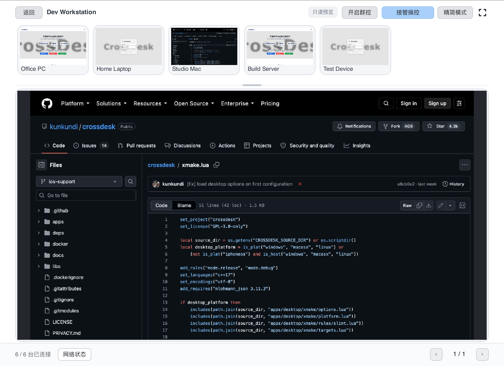
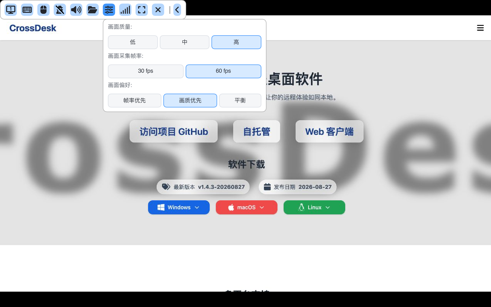
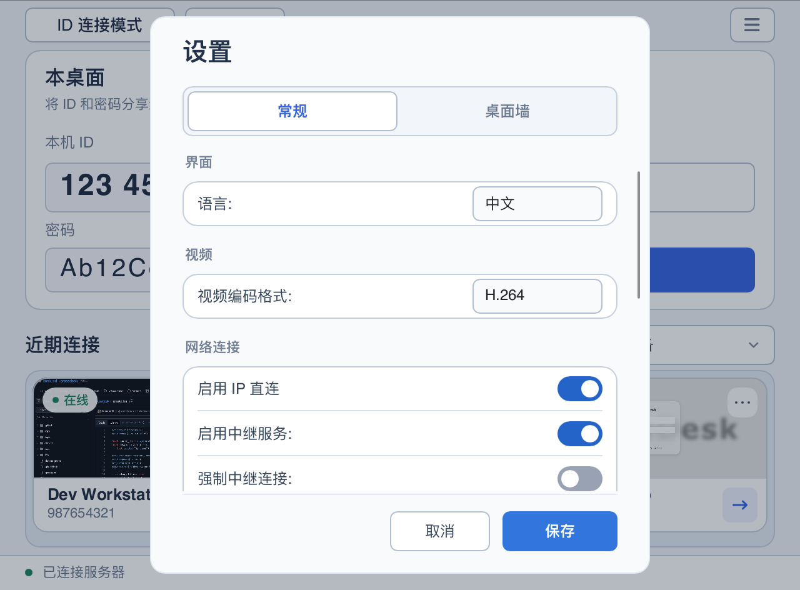
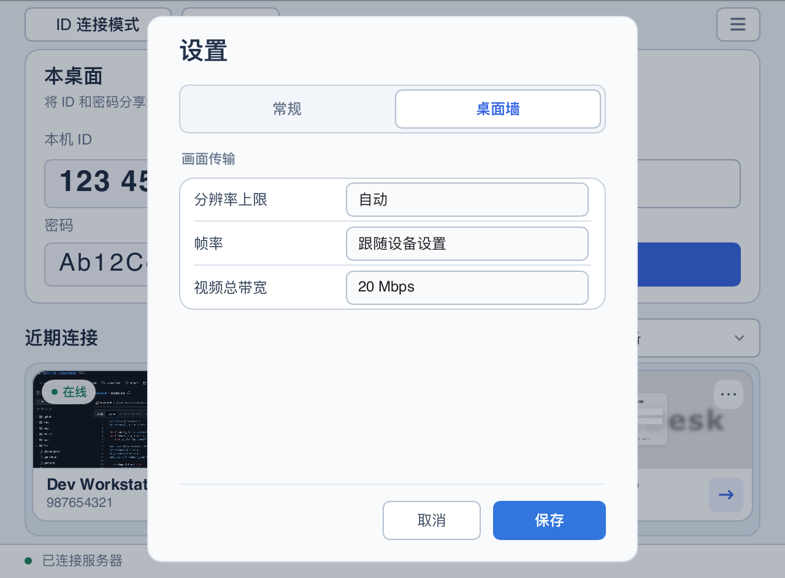
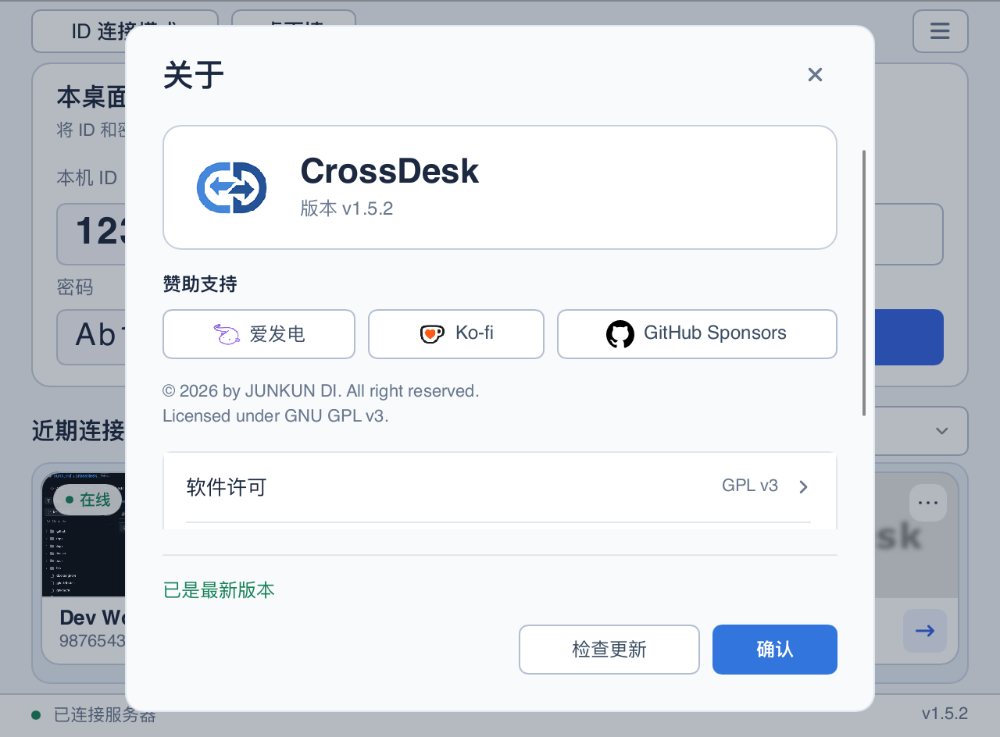
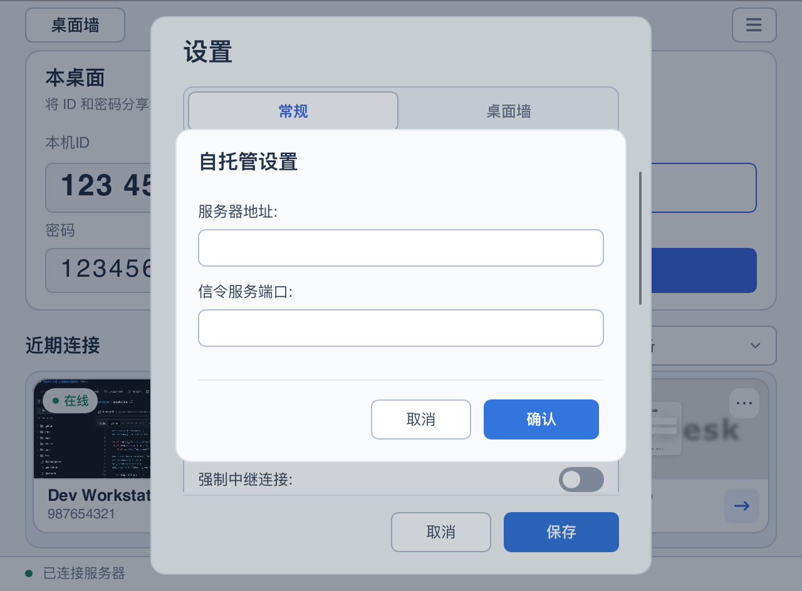

# CrossDesk 使用指南

[返回项目首页](../README.md) · [English](USER_GUIDE_EN.md)

首次使用请先查看 [下载与安装](../README.md#download)。本文介绍当前源码中的客户端操作；安装包的可用功能以对应 Release 为准。

[安装与权限](#installation) · [快速连接](#quick-start) · [桌面墙](#deskhub) · [会话操作](#session) · [设置与更新](#settings) · [iOS](#ios) · [Android](#android) · [鸿蒙](#harmonyos) · [Windows 无人值守](#windows-service) · [自托管](#self-hosting)

截图使用演示设备和凭据，来源与生成方式见 [截图说明](images/README.md)。

<a id="installation"></a>

## 安装补充与系统权限

Linux 每个架构提供两个可独立安装的包，**选择其中一个**：

| 安装包 | 适用场景 |
| --- | --- |
| `crossdesk-linux-<arch>-<version>.deb`（推荐） | 已有桌面的电脑；不会额外安装 Xfce 或 Xvfb |
| `crossdesk-virtual-desktop-xfce-linux-<arch>-<version>.deb` | 需要创建独立桌面的服务器；APT 会额外安装 **Xfce、Xvfb 和 D-Bus 会话工具** |

普通版安装示例（将文件名替换为实际下载名称，arm64 选择对应架构）：

```bash
sudo apt install "./crossdesk-linux-amd64-<version>.deb"
```

如需虚拟桌面版，改为安装：

```bash
sudo apt install "./crossdesk-virtual-desktop-xfce-linux-amd64-<version>.deb"
```

两个包包含相同的完整程序，互相替换并保留用户配置；普通版自行补齐依赖后也能创建虚拟桌面。安装虚拟桌面版不会自动启动会话或切换默认桌面，启动方法见 [Linux 无头运行](HEADLESS.md)。应用更新的下载按钮会选择已安装的包类型。已有版本升级后不会自动删除先前安装的 Xfce。

**macOS 首次运行：** 按应用提示，在“系统设置 → 隐私与安全性”中授予 CrossDesk **屏幕录制**（新系统可能显示为“屏幕与系统音频录制”）及 **辅助功能**权限，再按系统提示重新打开应用。前者用于捕获桌面，后者用于远程键鼠输入。

<a id="quick-start"></a>

## 快速连接

### 从另一台电脑连接

1. **准备被控电脑。** 安装并运行 CrossDesk，等待底部显示“已连接服务器”。在左侧“本桌面”查看 **本机 ID** 和 **密码**，提供给控制端。
2. **输入对端 ID。** 在控制端右侧“远程桌面 → 对端 ID”输入被控电脑的 **9 位 ID**，点击 **连接**。
3. **完成密码验证。** 按弹窗输入被控电脑当前的连接密码，确认后等待远程画面出现。需要保存密码时勾选“记住密码”。
4. **再次连接。** 成功连接过的设备会出现在“近期连接”中，可通过卡片重连。点击卡片右上角的“…”菜单可编辑别名、修改分组或删除记录，右下角按钮用于连接 / 断开；标题右侧可按分组筛选设备。

本机密码旁的眼睛按钮用于显示 / 隐藏密码，刷新按钮用于生成新的随机密码，铅笔按钮用于手动修改。密码统一为 **6 位数字或英文字母**。修改或刷新时需保持连接服务器；等待修改成功、客户端重新连接后，再复制当前密码。已保存旧密码的控制端需重新输入。

### 从浏览器连接

1. 保持被控电脑上的 CrossDesk 运行，并确认已连接服务器。
2. 打开 [Web 客户端](https://web.crossdesk.cn/)，输入 **远程设备 ID** 和 **密码**，点击“连接”。
3. 连接后使用页面提供的显示器、鼠标模式和键盘控件操作远端；手机和平板也可通过浏览器访问。

如果使用自建服务器，需要让控制端与被控端接入同一服务；Web 部署配置见 [CrossDesk Web Client](https://github.com/kunkundi/crossdesk-web-client)。

<p align="center">
  
</p>

<a id="deskhub"></a>

## 桌面墙：集中查看与操控多台设备

点击主窗口左上角 **桌面墙**，打开独立窗口；连接窗口仍可用于普通远程连接和全局设置。桌面墙会保存设备成员、分组、排序与窗口布局，重启后需要手动连接设备。

1. **添加设备。** 点击 **添加 → 通过设备 ID 添加**，填写 ID、密码及可选分组，点击“添加并连接”；只有勾选“记住密码”才保存凭据。也可选择 **从近期连接添加**，多选已有记录并导入；导入后用“选择 → 连接”发起连接。
2. **查看与整理。** 从“全部设备”切换到指定分组；拖动网格分隔线统一调整画面大小，拖动设备到另一台设备上交换位置。精简模式隐藏名称和管理工具栏，全屏用于扩大查看区域；翻页保留连接。
3. **放大与操控。** 点击设备画面进入只读放大视图，上方缩略图可切换设备，拖动中间分隔条可调整上下区域。点击 **接管操控** 后才发送键鼠；点击“释放操控”或按 **Ctrl / ⌘ + Shift + Esc** 释放。切换设备或窗口失焦也会释放操控。
4. **批量操作。** 点击 **选择**，勾选设备或“全选”，执行连接、断开，或从“更多”中静音 / 取消静音、分发文件。“全选”覆盖当前分组的全部分页；切换分组会清空选择。

<p align="center">
  
</p>

**群控：** 在放大视图点击“开启群控”，将当前设备的键鼠操作同步到 **所有已连接设备**，包含其他分组、分页及未显示在墙内的连接；范围不受批量勾选限制。各设备接收相同坐标与按键，屏幕尺寸不同时不会另做比例适配。释放操控会同时结束群控。

桌面墙连接默认静音，需要声音时通过“选择 → 更多 → 取消静音”开启。底部 **网络状态** 可查看所有已连接设备的直连 / 中继、加密状态、收发速率、视频延时、丢包率、分辨率与帧率。需要显示器切换、隐私屏等完整单会话工具时，可在主窗口“近期连接”中点击已连接设备，打开独立会话窗口。

**关闭桌面墙会断开全部远程设备连接，并关闭共用连接的独立会话窗口；最小化不会断开。** 分组、分页和选择范围不会限制关闭时的断开范围。更多操作、预览策略与版本兼容性见 [桌面墙说明](deskhub.md)。

<a id="session"></a>

## 会话中的常用操作

远程窗口通过会话标签切换设备，控制栏提供以下操作；控制栏收起时先点击展开按钮。将鼠标悬停在图标上可查看提示。

| 入口 | 用途 |
| --- | --- |
| 显示器 | 切换远端显示器 |
| 键盘 | 发送组合键；Windows 的 `Ctrl+Alt+Del` 依赖远端服务 |
| 鼠标 | 控制 / 释放远端鼠标 |
| 扬声器 | 播放声音 / 静音 |
| 文件夹 | 选择文件发送到远端，并查看传输进度 |
| 画面设置 | 在当前会话中调整画面质量、采集帧率与画面偏好 |
| 网络状态 | 查看流量、丢包率、帧率、分辨率、直连 / 中继、加密状态，以及被控端编码器和控制端解码器 |
| 隐私屏 | 开启或关闭被控电脑的隐私屏；悬停查看当前状态与可用操作 |
| 全屏 | 进入 / 退出全屏 |
| 断开连接 | 结束当前远程会话 |

桌面端可同步文本剪贴板。接收文件的位置可在“设置 → 常规 → 文件保存路径”调整。关闭主窗口会隐藏窗口并保持程序运行；需要完全退出时使用系统托盘或菜单栏中的退出入口。

普通会话与桌面墙的网络状态均显示实际使用的视频编解码器名称，包括回退后的软件编解码器。名称统一采用“实现名称 (编码格式)”，名称首字母大写、技术缩写保留全大写，例如 `VideoToolbox (H.264)`、`NVENC (H.264)`、`NVDEC (H.264)`、`SVT-AV1 (AV1)`、`Dav1d (AV1)` 和 `LibAOM (AV1)`；Media Foundation 额外标注 `HW`（硬件）或 `SW`（软件）。被控端需要支持编码器状态上报；旧版本或尚未获取到的信息显示“—”。

### 在会话中调整画面

连接成功后，点击工具栏中的 **画面设置**（滑杆图标），直接选择低 / 中 / 高画质、**30 / 60 fps**，以及帧率优先 / 画质优先 / 平衡。选项会发送给当前被控端，无需断开重连；实际画面效果取决于网络、设备与编码器能力。旧版被控端不支持时，菜单会提示并禁用选项。

<p align="center">
  
</p>

<a id="settings"></a>

## 客户端设置与更新

点击主窗口右上角 **☰ → 设置**，顶部切换 **常规 / 桌面墙**，修改后点击 **保存**。切换选项卡会保留未保存的修改，点击“取消”放弃修改。“常规”按界面、视频、网络连接等类别组织选项，可向下滚动查看其余设置。编码与连接选项建议在建立连接前调整；会话进行中部分选项不可修改。普通会话的画质、帧率和画面偏好在远程会话工具栏中调整。

<p align="center">
  
</p>

| 设置 | 说明 |
| --- | --- |
| 语言 | 中文、English、Русский |
| 采集方式（Windows） | 自动 / DXGI / WGC / GDI；无显示器主机使用“自动”启用自动适配 |
| 视频编码格式 | H.264 / AV1；H.264 自动优先使用硬件编解码，不可用或初始化失败时回退到软件；桌面端 AV1 使用软件编解码 |
| 启用中继服务 | 允许借助 TURN 中继建立连接；P2P 连接失败时先检查此项 |
| 强制中继连接 | 启用中继服务后可勾选，让连接通过中继建立；关闭中继服务会同时关闭此项 |
| 保存远程画面预览 | 默认开启，保存远程画面预览；关闭后缩略图区域显示被控端平台，并清除已有预览，保留连接记录和密码 |
| 被连接时开启隐私屏 | 设置本机被远程连接时是否自动启用隐私屏；会话中可从控制端工具栏切换 |
| 自托管配置 | 填写服务器地址和信令服务端口，并勾选启用 |
| 开机自启 / 启用守护进程 | 调整启动与进程守护行为，按界面提示重启后生效 |
| 文件保存路径 | 选择接收文件的目录 |

### 桌面墙画面传输

在 **设置 → 桌面墙** 中统一配置墙内设备，保存后立即应用到当前桌面墙会话，并用于后续连接；普通连接不受影响。

| 设置 | 说明 |
| --- | --- |
| 分辨率上限 | 自动、320 × 180、640 × 360、1280 × 720、1920 × 1080、2560 × 1440、3840 × 2160 或原始分辨率；自动模式按网格 / 放大视图调整，固定上限保持比例且不放大源画面 |
| 帧率 | 跟随设备设置，或指定 15 / 30 / 60 FPS |
| 视频总带宽 | 默认 20 Mbps，可选 2 / 5 / 10 / 20 / 50 / 100 Mbps；由支持该能力的桌面墙会话共享，放大画面优先分配，不包含音频、文件传输与普通连接，也不是瞬时流量的硬上限 |

<p align="center">
  
</p>

支持预览订阅的设备在不可见时可暂停视频传输，重新可见时恢复；旧版被控端按其能力回退，不保证所有分辨率、帧率或带宽选项都生效。

### 检查更新

客户端启动后会在后台检查版本，发现新版本时自动弹出更新提示，可查看更新说明并前往下载页面。关闭提示后，本次运行中的后台检查不会再次弹窗，主窗口菜单入口仍会显示更新提示；重新启动客户端后，如仍有新版本则再次提示。打开 **☰ → 关于** 可查看版本；有新版本时，点击版本信息下方的 **更新日志** 可再次打开更新提示，也可点击 **检查更新** 手动检查。

<p align="center">
  
</p>

<a id="ios"></a>

## 原生 iOS / iPadOS 客户端

仓库的 [`apps/ios`](../apps/ios/README.md) 提供原生控制端，与桌面端使用同一套 MiniRTC 协议。它可以控制远端电脑；当前不提供将 iPhone / iPad 作为被控桌面的功能。

1. 按 [iOS 开发说明](../apps/ios/README.md) 使用 Xcode 构建并签名，安装到 iOS 16+ 的真机。
2. 在首页输入对端 ID，点击连接并填写密码；成功连接后可从“最近连接”中重连。
3. 在设置中选择鼠标模式：**相对位置**像触控板一样移动光标，**绝对位置**将触摸位置直接映射到远端画面。
4. 点击悬浮图标展开菜单，可切换显示器、显示键盘、控制声音或发送文件。收到的文件位于应用的 `Documents/Received`，可通过传输状态旁的分享按钮导出。

支持接收远端文本到 iOS 剪贴板；点击悬浮菜单中的 **剪贴板** 可发送本机文本到远端。单次文本上限为 **128 KiB**；空文本或超出限制时会显示提示。

当前支持单指点击、双指右键、长按拖动与捏合缩放；缩放后的双指平移用于移动视图。原生端与浏览器端分别维护，使用入口和手势可能不同。

<a id="android"></a>

## 原生 Android 控制端

Android 客户端支持 Android 8.0+ 的 arm64 手机和平板，可从 [官网](https://www.crossdesk.cn/) 或 [GitHub Releases](https://github.com/kunkundi/crossdesk/releases) 下载已签名 APK 安装。自行构建见 [Android 开发说明](../apps/android/README.md)。

1. 在电脑上运行 CrossDesk，在手机首页输入电脑端的设备 ID，连接后填写密码。
2. 在设置中选择相对鼠标（触控板）或绝对位置模式。支持长按右键、双指滚动、捏合缩放，以及外接键盘和鼠标。
3. 展开悬浮菜单，可切换显示器、调节画质与帧率、使用虚拟鼠标、收发文件、查看网络状态，以及发送剪贴板文本。接收的文件可通过保存入口导出。
4. 切换应用时，已有会话优先通过系统画中画保持；画中画不可用时尝试使用带通知的前台服务。关闭画中画窗口或后台保活未能启动会结束会话。

H.264 / AV1 优先使用 MediaCodec 硬件解码；设备不支持或运行失败时回退到对应软件解码器。实际效果取决于设备能力。Android 当前不提供手机被控或隐私屏功能。

<a id="harmonyos"></a>

## 鸿蒙（HarmonyOS）支持

CrossDesk 已支持鸿蒙 PC、手机和平板，PC 与移动端分别构建 HAP，应用名称统一为 **CrossDesk**，包名统一为 `com.chunkdash.crossdesk`。

| 客户端 | 系统与架构 | 功能 |
| --- | --- | --- |
| 鸿蒙 PC（`2in1`） | API 26，arm64 | 可作为控制端和被控端，复用公共 Slint 桌面界面、会话管理、桌面墙与文件传输 |
| 鸿蒙手机 / 平板 | API 20+，arm64 | 原生 ArkUI 控制端，支持远端画面与声音、触控和外接键鼠、多屏切换、文本剪贴板及双向文件传输 |

鸿蒙 PC、移动端与其他 PC 平台共用文件传输核心。移动端通过系统文件选择器发送和导出文件，PC 可在设置中选择接收目录。

当前为开发版，需按 [鸿蒙构建说明](../apps/harmony/README.md) 使用 DevEco 构建并签名后安装。PC 录屏和输入控制需获得相应系统授权，真机与长期会话验收仍在进行；具体权限、平台差异及验证范围见 [PC 说明](../apps/harmony/desktop-port/README.md) 与 [移动端功能说明](../apps/harmony/MOBILE_PARITY.md)。

<a id="windows-service"></a>

## Windows 锁屏与登录界面

**CrossDesk Service**（服务名 `CrossDeskService`）提供锁屏、登录、凭据输入及安全桌面的状态上报、`Ctrl+Alt+Del` 发送和键鼠输入转发。

安装版默认注册按需启动的服务，客户端启动时尝试启动它；未启用无人值守时，本机没有 CrossDesk 客户端进程后服务会自动退出。便携版可在提示窗口或“设置 → 锁屏控制服务”中安装服务，需要管理员权限。

Windows 的“开机自启”在当前用户登录后启动客户端。安装版使用以最高权限运行的登录计划任务，后续登录无需再次确认 UAC；便携版和 Debug 构建使用当前用户的普通启动项。升级安装版或手动启动新版时，会自动迁移指向该程序的旧启动项。关闭自启会删除相应注册。登录前远控需要另外启用下面的无人值守模式。

### 开机后尚未登录时远控

安装版支持独立的无人值守被控端。在完整安装目录中打开**管理员 PowerShell**，一次性启用：

```powershell
.\CrossDesk.exe --unattended-enable
# 等待联网注册后，查看独立设备 ID、密码和 online 状态
.\CrossDesk.exe --unattended-status
```

使用返回的 `device_id` 和 `password` 从另一台设备连接。首次启用时复制当前客户端的服务器和编码设置，单独生成无人值守凭据；它与普通客户端的设备 ID 不同，重启、注销和重新启用时保留。后续执行启用命令会复用机器配置，不会覆盖它。自建服务器的根证书需要安装到本地计算机的信任存储中。

启用后，`CrossDeskService` 改为系统启动时自动运行，无需 Windows 自动登录，也不需要保存 Windows 登录密码。服务以 SYSTEM 身份在当前控制台会话中启动无界面的被控进程，复用登录界面抓屏、键鼠及 `Ctrl+Alt+Del` 支持。用户登录、锁屏和关闭普通客户端不会停止它；注销、切换用户或进程崩溃后服务会重新拉起，期间连接可能中断，需要重新连接同一设备 ID。启动时网络尚未就绪会继续重试。

无人值守模式提供画面、键鼠、多屏切换和安全桌面控制；不提供声音、文件传输、剪贴板或隐私遮罩。便携版和 Debug 构建不能启用此模式。设置和凭据位于 `%ProgramData%\CrossDeskUnattended`，只允许 SYSTEM 和管理员访问；日志位于其 `logs` 子目录。

```powershell
# 停止无人值守被控端，并恢复服务按需启动
.\CrossDesk.exe --unattended-disable
```

关闭普通“开机自启”不会关闭无人值守模式。禁用或卸载服务会取消无人值守启动，但保留受保护的机器配置；若需彻底清除凭据，在服务停止后由管理员删除该目录。

<details>
<summary>手动部署与服务管理命令</summary>

保留完整安装目录；自行部署构建产物时，将 `CrossDesk.exe`、`crossdesk_service.exe`、`crossdesk_session_helper.exe` 及同次构建输出的全部 `.dll` 放在同一目录。在该目录打开管理员 PowerShell，按需执行：

```powershell
.\CrossDesk.exe --service-install
.\CrossDesk.exe --service-start
.\CrossDesk.exe --service-status
.\CrossDesk.exe --service-ping
# 停止或卸载服务
.\CrossDesk.exe --service-stop
.\CrossDesk.exe --service-uninstall
```

</details>

出现“远端 Windows 服务不可用”时，检查被控电脑的安装和服务状态；普通桌面连接仍可使用，受保护界面的控制能力会受限。

<a id="self-hosting"></a>

## 自托管服务器

可自行部署信令服务与 TURN 中继，并在桌面客户端 **☰ → 设置 → 常规 → 自托管配置** 中填写连接信息。控制端与被控端都需要启用同一套配置。

- [自托管指南](SELF_HOSTING.md)：当前 Compose 部署入口、客户端设置、证书信任与排查。
- [CrossDesk Server](https://github.com/kunkundi/crossdesk-server)：服务端源码与发布配置。
- [CrossDesk Web Client](https://github.com/kunkundi/crossdesk-web-client)：浏览器端源码与自托管说明。

<p align="center">
  
</p>
