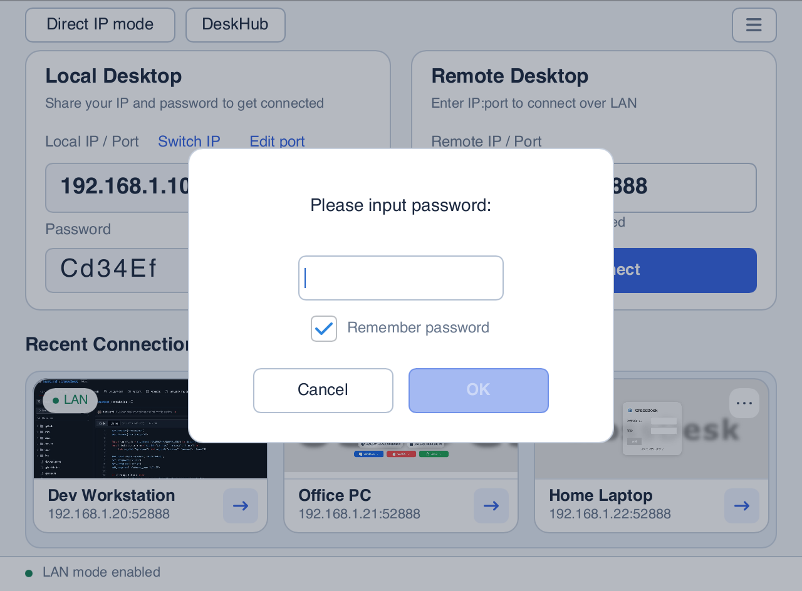
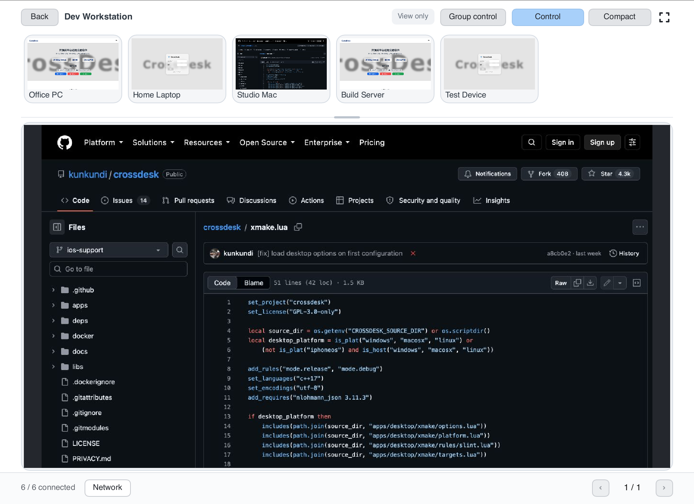
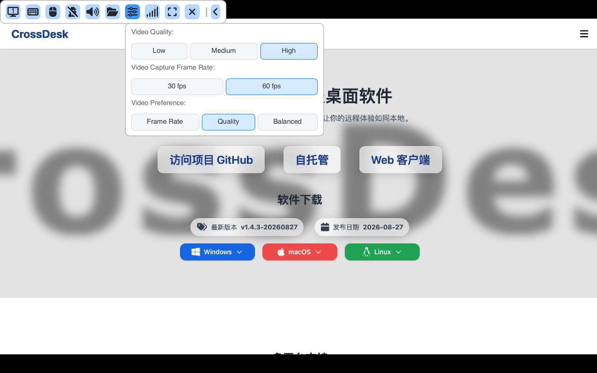
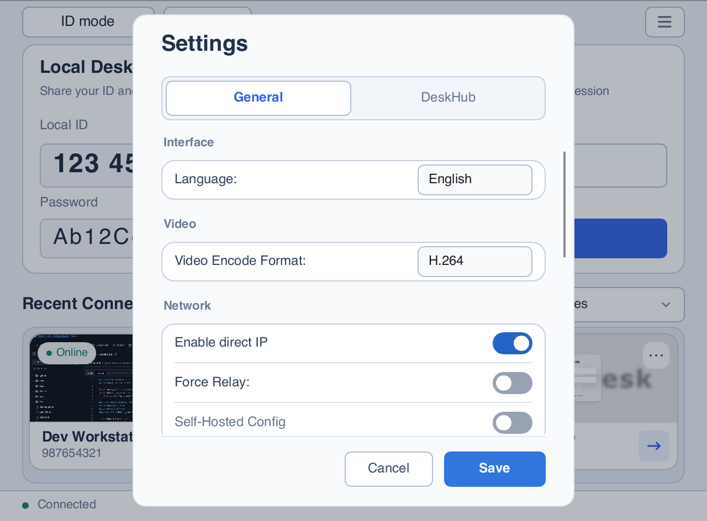
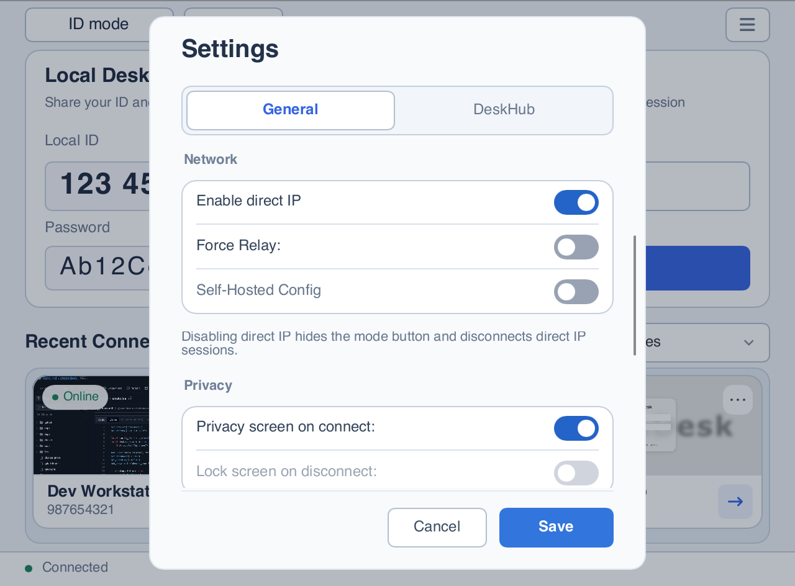
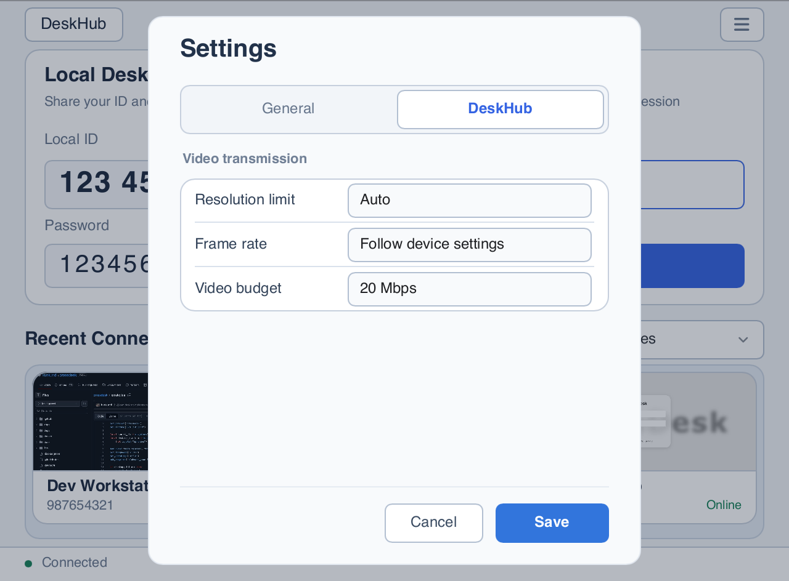
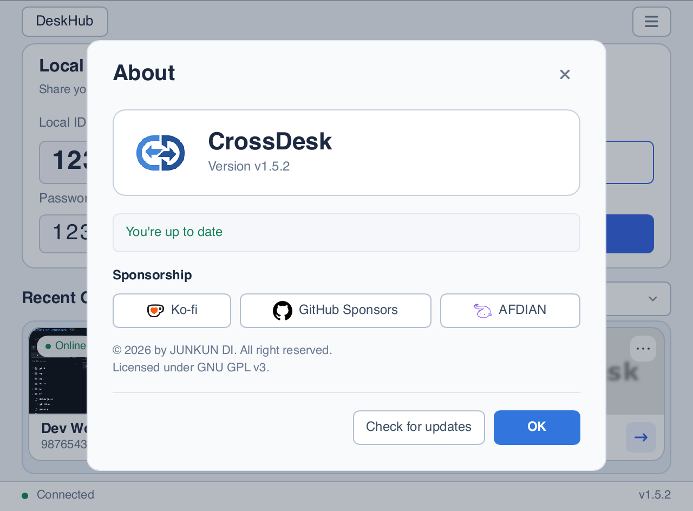
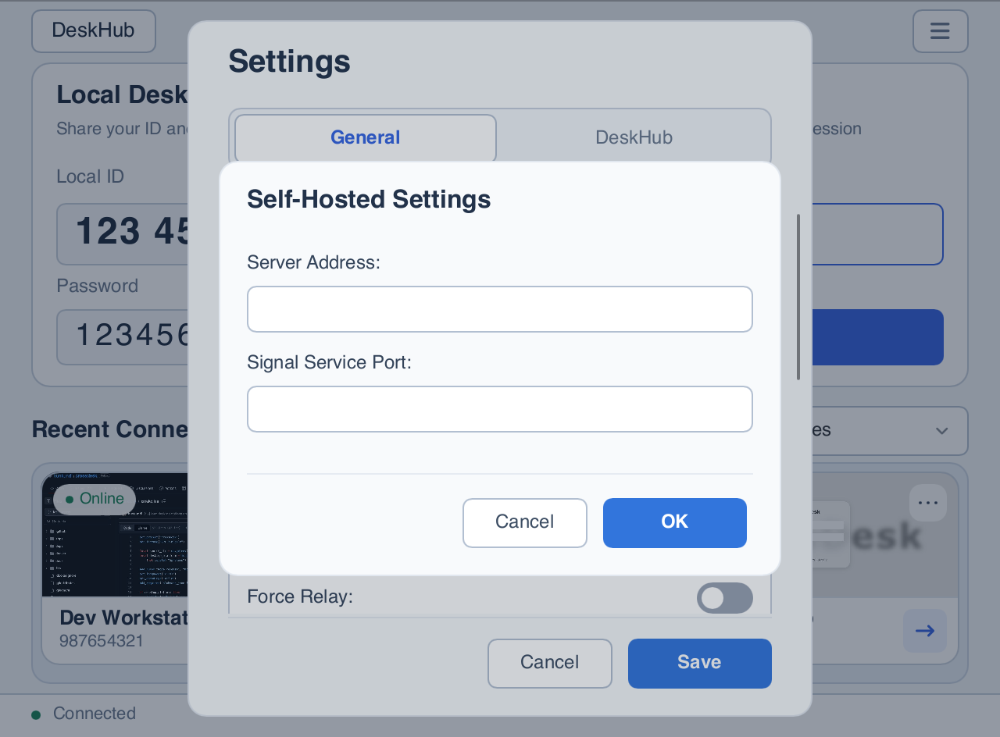

# CrossDesk user guide

[Project overview](../README_EN.md) · [中文](USER_GUIDE.md)

Start with [download and installation](../README_EN.md#download). This guide describes the current source; check the release notes for the features available in a downloaded build.

[Installation and permissions](#installation) · [Quick start](#quick-start) · [Direct IP](#lan-direct) · [DeskHub](#deskhub) · [Session controls](#session) · [Settings and updates](#settings) · [iOS](#ios) · [Android](#android) · [HarmonyOS](#harmonyos) · [Windows unattended access](#windows-service) · [Self-hosting](#self-hosting)

Screenshots use demonstration devices and credentials. See the [screenshot notes](images/README.md) for sources and reproduction instructions.

<a id="installation"></a>

## Installation details and permissions

Linux provides two standalone packages per architecture. **Choose one**:

| Package | Intended use |
| --- | --- |
| `crossdesk-linux-<arch>-<version>.deb` (recommended) | Computers with an existing desktop; does not install Xfce or Xvfb |
| `crossdesk-virtual-desktop-xfce-linux-<arch>-<version>.deb` | Servers needing an independent desktop; APT additionally installs **Xfce, Xvfb and D-Bus session tools** |

To install the standard package, replace the example filename with your download (use arm64 for that architecture):

```bash
sudo apt install "./crossdesk-linux-amd64-<version>.deb"
```

For the virtual desktop package, install this file instead:

```bash
sudo apt install "./crossdesk-virtual-desktop-xfce-linux-amd64-<version>.deb"
```

Both contain the same complete application, replace each other and preserve user settings. The standard package can also create virtual desktops after you install the optional dependencies. Installing the virtual desktop package does not start a session or change the default desktop; see [Linux headless operation](HEADLESS_EN.md) to start one. The app's update download button selects the installed package type. Upgrading an existing installation does not automatically remove previously installed Xfce components.

**First launch on macOS:** follow the app prompts to grant **Screen Recording** (called **Screen & System Audio Recording** on newer systems) and **Accessibility** under **System Settings → Privacy & Security**. Reopen the app if prompted. These permissions allow desktop capture and remote keyboard/mouse input respectively.

<a id="quick-start"></a>

## Quick start

### Connect from another computer by device ID

1. **Prepare the host.** Install and run CrossDesk on the computer to control and select ID mode. Wait for the bottom status bar to show that the server is connected. Share the **Local ID** and **Password** shown under **Local Desktop** with the controller.
2. **Enter the remote ID.** On the controlling computer, enter the host's **9-digit ID** in **Remote Desktop → Remote ID**, then click **Connect**.
3. **Verify the password.** Enter the host's current connection password when prompted and confirm. Select **Remember password** if you want to save it.
4. **Reconnect later.** Previously connected devices appear under **Recent Connections**. Reconnect from a card, open its top-right **…** menu to rename it, edit its groups, or remove its record, and use the bottom-right button to connect / disconnect. Use the group filter beside the heading to narrow the list.

The eye button shows or hides the local password, the refresh button generates a new random password, and the pencil button lets you edit it. Passwords use **6 ASCII letters or digits**. Stay connected to the server when editing or refreshing a password. Wait for the change to succeed and the client to reconnect, then copy the current password. Controllers that saved the old password must enter it again.

<a id="lan-direct"></a>

### Connect directly over LAN

The direct IP entry is available in the regular Windows, macOS, and Linux desktop clients. The computers must have mutually reachable IPv4 addresses. Internet access is optional, and there is no need to wait for a signaling server connection. Browsers, mobile clients, the Windows pre-sign-in service, and the Linux headless console currently use the device ID workflow.

1. **Enable and switch.** On both computers, select **Enable direct IP** under **Settings → General → Network** and save (enabled by default). Use the top-left button to switch to **Direct IP mode**.
2. **Get the host address.** Read **Local IP / Port** on the host. The copy button copies the full `IP:port`. If several addresses are available, choose one reachable from the controller.
3. **Connect and verify.** Enter an address such as `192.168.1.20:52888` under **Remote IP / Port**, click **Connect**, and enter the host's six-character password for this mode. Omitting the port uses **52888**. Only numeric IPv4 addresses are currently supported, not hostnames or IPv6.
4. **Save and reconnect.** Select **Remember password** in the password dialog if needed. Recent connections are separated by ID / IP mode. Device records are kept even without a saved password; you will be prompted next time. Cards let you reconnect, rename devices, or remove records.

<p align="center">
  
</p>

**Addresses and ports:** use **Switch IP** to choose the displayed address and **Edit port** to change its port. The app listens on available physical-interface IPv4 addresses simultaneously and saves a separate port for each IP. Selecting a displayed address keeps the others listening. The first port assignment for an IP tries **52888**; if busy, it allocates and saves an available port. A conflict on an already saved port is reported and requires a manual change. Valid ports are **1–65535**; failed changes preserve the previous settings. Connect using the actual port displayed on the host. The LAN firewall must allow CrossDesk's TCP negotiation connection and UDP remote-control traffic.

**Passwords:** direct IP has its own **six-character, case-sensitive ASCII letter/digit password**. A missing password is generated automatically. Use the eye, refresh, and pencil buttons to show/hide, randomly generate, or customize it. A successful change applies immediately without restarting or connecting to a server. Controllers that saved the old password must enter the new one.

**Mode and availability:** the selected mode is remembered at the next launch. Switching back to ID mode changes the connection controls and recent list while IP listeners keep running. To stop direct IP, clear **Enable direct IP** in Settings and save. This disconnects IP sessions, releases listening ports, returns to ID mode, and hides the mode button. Existing ID sessions continue; IP passwords, ports, and recent records are retained for re-enabling.

### Connect from a browser

1. Keep CrossDesk running and connected to the server on the host computer.
2. Open the [Web Client](https://web.crossdesk.cn/), enter the **Remote Device ID** and **Password**, and click **Connect**.
3. Use the page's display, mouse-mode, and keyboard controls during the session. Phone and tablet browsers can also connect.

For self-hosting, connect both sides to the same service. Browser deployment is documented in [CrossDesk Web Client](https://github.com/kunkundi/crossdesk-web-client).

<p align="center">
  
</p>

<a id="deskhub"></a>

## DeskHub: view and control multiple devices

Click **DeskHub** at the top left of the main window to open a separate window. The connection window remains available for ordinary remote sessions and global settings. DeskHub saves its device membership, groups, order, and window layout; connections must be started manually after relaunching.

1. **Add devices.** Choose **Add → Add by device ID**, enter an ID, password, and optional group, then click **Add and connect**. Credentials are saved only when you select **Remember password**. Alternatively, choose **Add from recent** and import multiple records; use **Select → Connect** to connect after importing.
2. **Arrange the view.** Switch from **All devices** to a group, drag grid dividers to resize all previews, or drag a device onto another to swap positions. **Compact** hides device names and management controls; fullscreen provides more viewing space. Changing pages keeps connections open.
3. **Enlarge and control.** Click a preview to open a read-only enlarged view. Switch devices with the thumbnails above it, and drag the divider to resize the two areas. Click **Control** to send keyboard and mouse input. Click **Release** or press **Ctrl / ⌘ + Shift + Esc** to release; switching devices or losing window focus also releases control.
4. **Apply batch actions.** Click **Select**, choose devices or **Select all**, and connect, disconnect with **Close**, or use **More** to mute / unmute or send a file. **Select all** includes every page in the current group; switching groups clears the selection.

<p align="center">
  
</p>

**Group control:** click **Group control** in the enlarged view to mirror input from the current device to **all connected devices**, including other groups, pages, and connections not displayed in the wall. The scope is independent of the batch selection. Devices receive the same coordinates and keys without additional scaling for different screen sizes. Releasing control also ends group control.

DeskHub connections are muted by default. Enable sound with **Select → More → Unmute**. The bottom **Network** button shows direct / relay mode, encryption, receive/send rates, video latency, packet loss, resolution, and frame rate for all connected devices. For the full single-session toolbar, including display switching and privacy screens, click a connected device under **Recent Connections** in the main window to open its separate session window.

**Closing DeskHub disconnects all remote devices and closes session windows sharing those connections; minimizing it keeps connections open.** The disconnect scope includes all groups and pages, regardless of selection. See the [DeskHub guide](deskhub.md) (Chinese) for further controls, preview behavior, and compatibility details.

<a id="session"></a>

## Session controls

Switch devices using session tabs. Expand the control bar if it is collapsed, and hover over icons to see their tooltips.

| Control | Action |
| --- | --- |
| Display | Switch the remote monitor |
| Keyboard | Send shortcuts; Windows `Ctrl+Alt+Del` requires the remote service |
| Mouse | Enable / release remote mouse control |
| Speaker | Play / mute remote audio |
| Folder | Select a file to send and view transfer progress |
| Video settings | Adjust video quality, capture frame rate, and video preference during the current session |
| Network statistics | Inspect traffic, packet loss, frame rate, resolution, direct / relay mode, encryption status, the remote encoder, and the local decoder |
| Privacy screen | Enable or disable the host's privacy screen; hover to see its status and available actions |
| Fullscreen | Enter / exit fullscreen |
| Disconnect | End the current remote session |

Desktop clients synchronize text clipboard contents. Configure the receiving directory under **Settings → General → File Save Path**. Closing the main window hides it and keeps the app running; use the system tray or menu-bar exit command to quit completely.

Network statistics in both ordinary sessions and DeskHub show the video codecs actually in use, including software fallback. Names use “Implementation (Format)” with an initial capital and uppercase technical abbreviations, such as `VideoToolbox (H.264)`, `NVENC (H.264)`, `NVDEC (H.264)`, `SVT-AV1 (AV1)`, `Dav1d (AV1)`, and `LibAOM (AV1)`; Media Foundation also includes `HW` (hardware) or `SW` (software). The host must support encoder status reporting; older versions and information not yet available display “—”.

### Adjust video during a session

After connecting, open **Video settings** (the sliders icon) in the toolbar. Choose low / medium / high quality, **30 / 60 fps**, and frame-rate priority / quality priority / balanced adaptation. Changes are sent to the current host without reconnecting; actual results depend on the network, device, and encoder. For older hosts that do not support live video settings, the menu explains the limitation and disables the options.

<p align="center">
  
</p>

<a id="settings"></a>

## Client settings and updates

Open **☰ → Settings** in the top-right corner, choose **General / DeskHub**, and click **Save** to apply changes. Switching tabs preserves pending changes; **Cancel** discards them. General settings are grouped into interface, video, networking, and further sections available by scrolling. Configure codecs and connections before connecting; some settings are disabled during an active session. Adjust ordinary session quality, frame rate, and video preference from its toolbar.

<p align="center">
  
</p>

| Setting | Purpose |
| --- | --- |
| Language | 中文, English, Русский |
| Capture Method (Windows) | Auto / DXGI / WGC / GDI; choose Auto for automatic headless adaptation |
| Video Encode Format | H.264 / AV1; H.264 automatically prefers hardware codecs, with software fallback when unavailable or initialization fails; desktop AV1 uses software codecs |
| Enable direct IP | Enabled by default; saving starts or stops direct IP immediately. Disabling disconnects IP sessions, stops listeners, and hides the mode button; the choice persists across restarts |
| Force Relay | When off, automatically select a connection path with P2P and TURN relay fallback; when on, use relay connections only |
| Save remote screen previews | On by default. When disabled, the thumbnail area shows the remote device’s platform and existing previews are cleared; connection records and passwords are preserved |
| Privacy screen on connect | Automatically enable privacy when this computer is controlled remotely; the controller can toggle it from the session toolbar |
| Self-Hosted Config | Set the server address and signaling port, then enable the checkbox |
| Auto Start / Enable Daemon | Configure startup and process supervision; restart as indicated by the UI |
| File Save Path | Choose where received files are saved |

The direct IP switch in the Network group is independent of the relay settings used for ID connections:

<p align="center">
  
</p>

### DeskHub video transmission

Use **Settings → DeskHub** to configure wall sessions together. Saving applies changes immediately to current DeskHub sessions and future connections; ordinary connections are unaffected.

| Setting | Purpose |
| --- | --- |
| Resolution limit | Auto, 320 × 180, 640 × 360, 1280 × 720, 1920 × 1080, 2560 × 1440, 3840 × 2160, or Original resolution; Auto adapts to grid / enlarged views, while fixed limits preserve aspect ratio without upscaling the source |
| Frame rate | Follow device settings, or choose 15 / 30 / 60 FPS |
| Video budget | Defaults to 20 Mbps; choose 2 / 5 / 10 / 20 / 50 / 100 Mbps, shared by compatible DeskHub sessions with priority for enlarged views. Audio, file transfers, and ordinary connections are excluded; this is not a hard limit on instantaneous traffic |

<p align="center">
  
</p>

Devices supporting preview subscriptions can pause video while their views are hidden and resume when visible. Older hosts fall back according to their capabilities, so not every resolution, frame-rate, or bandwidth setting will apply.

### Check for updates

The client checks for updates in the background after launch and automatically opens the update dialog when a new version is found, showing release notes and a link to the download page. After you dismiss the dialog, background checks will not reopen it during the current run, while the main window menu keeps its update indicator. Restarting the client shows the dialog again if an update is still available. Open **☰ → About** to view the version. When an update is available, click **Release notes** below the new version to reopen the update dialog, or click **Check for updates** to check manually.

<p align="center">
  
</p>

<a id="ios"></a>

## Native iOS / iPadOS client

[`apps/ios`](../apps/ios/README.md) contains a native controller using the same MiniRTC protocol as the desktop client. It controls remote computers; it does not expose an iPhone or iPad as a remotely controlled desktop.

1. Follow the [iOS guide](../apps/ios/README.md) to build and sign the app with Xcode, then install it on an iOS 16+ physical device.
2. Enter a remote ID on the home screen, connect, and enter its password. Successful connections become available in the recent devices list.
3. Choose a mouse mode in Settings: **Relative Position** works like a trackpad; **Absolute Position** maps touches directly to the remote screen.
4. Tap the floating icon to expand the menu, then switch displays, open the keyboard, toggle audio, or send files. Received files are stored in `Documents/Received` and can be exported using the share button beside the transfer status.

The app receives remote text into the iOS clipboard. Tap **剪贴板** (Clipboard) in the floating menu to send local text to the remote computer. Text is limited to **128 KiB** per transfer; empty or oversized text displays a hint.

Gestures include one-finger click, two-finger right-click, long-press drag, and pinch-to-zoom. When zoomed in, two-finger panning moves the viewport. The native and browser clients are maintained separately, so their controls and gestures may differ. The current native UI uses Chinese labels.

<a id="android"></a>

## Native Android controller

The Android client supports Android 8.0+ arm64 phones and tablets. Install the signed APK from the [website](https://www.crossdesk.cn/) or [GitHub Releases](https://github.com/kunkundi/crossdesk/releases). See the [Android build guide](../apps/android/README.md) (Chinese) to build it yourself.

1. Run CrossDesk on the computer. Enter its device ID on the phone, connect, and enter its password.
2. Choose relative mouse (trackpad) or absolute positioning in Settings. Use long-press for right-click, two fingers to scroll, and pinch to zoom. External keyboards and mice are supported.
3. Open the floating menu to switch displays, adjust video quality and frame rate, use the virtual mouse, send and receive files, inspect network statistics, and send clipboard text. Use the save action to export received files.
4. When switching apps, an active session uses system Picture in Picture when available, with a foreground service and notification as a fallback. Closing the Picture in Picture window or failing to start background session support ends the session.

H.264 / AV1 use MediaCodec hardware decoding when available, with software fallback when unsupported or when decoding fails. Results depend on the device. Android does not currently support phone-as-host or privacy screens.

<a id="harmonyos"></a>

## HarmonyOS support

CrossDesk supports HarmonyOS PCs, phones, and tablets. PC and mobile clients use separate HAP builds, both named **CrossDesk** with the bundle name `com.chunkdash.crossdesk`.

| Client | System and architecture | Features |
| --- | --- | --- |
| HarmonyOS PC (`2in1`) | API 26, arm64 | Controller and host roles, sharing the Slint desktop UI, session management, DeskHub, and file transfer |
| HarmonyOS phones / tablets | API 20+, arm64 | Native ArkUI controller with remote video/audio, touch and external keyboard/mouse input, display switching, text clipboard, and bidirectional file transfer |

HarmonyOS PC and mobile clients share the file transfer core with other PC platforms. Mobile clients use the system picker to send and export files; PC users can choose the receive directory in Settings.

These are development builds. Follow the [HarmonyOS build guide](../apps/harmony/README.md) to build and sign them with DevEco before installation. PC screen capture and input control require system authorization, and physical-device and long-session validation are ongoing. See the [PC guide](../apps/harmony/desktop-port/README.md) and [mobile feature guide](../apps/harmony/MOBILE_PARITY.md) for permissions, platform differences, and validation coverage (Chinese).

<a id="windows-service"></a>

## Windows lock screens and sign-in

**CrossDesk Service** (`CrossDeskService`) reports protected desktop states and forwards `Ctrl+Alt+Del`, keyboard, and mouse input on lock screens, sign-in screens, credential prompts, and secure desktops.

The installer registers an on-demand service by default. CrossDesk tries to start it on launch. Unless unattended mode is enabled, the service exits when no local CrossDesk client is running. Portable builds offer service installation in the prompt or **Settings → Lock Screen Service**, with administrator privileges.

On Windows, **Auto Start** launches the client after the current user signs in. Installed release builds use a logon scheduled task with highest privileges, so subsequent logons need no UAC confirmation; portable and Debug builds use a normal per-user startup entry. Upgrading the installed build or launching the new version manually migrates a legacy startup entry pointing to that executable. Turning Auto Start off removes its registration. Remote access before sign-in requires the separate unattended mode below.

### Remote access before Windows sign-in

The installed release supports a separate unattended host. Open an **administrator PowerShell** in the complete installation directory and enable it once:

```powershell
.\CrossDesk.exe --unattended-enable
# After network registration, show its separate device ID, password and online state
.\CrossDesk.exe --unattended-status
```

Connect from another device using the returned `device_id` and `password`. First-time setup copies the current client's server and codec preferences and creates separate credentials. This ID differs from the GUI client's ID and persists across reboots, logoffs and re-enabling. Subsequent enable commands retain the machine configuration. Self-hosted server root certificates must be trusted in the Local Computer certificate store.

Once enabled, `CrossDeskService` starts automatically at system boot. Windows automatic login and saved Windows login passwords are unnecessary. The service launches a windowless SYSTEM host in the active console session and reuses secure-desktop capture, keyboard/mouse input and `Ctrl+Alt+Del`. Signing in, locking Windows or closing the ordinary client does not stop it. Logoff, user switching or a host crash causes the service to restart the host; the connection may drop, and you can reconnect using the same ID. Network connections retry if networking is unavailable during boot.

Unattended mode supports screen viewing, keyboard/mouse input, monitor switching and secure desktops. Audio, file transfer, clipboard and privacy screens are unavailable. Portable and Debug builds cannot enable it. Configuration and credentials reside in `%ProgramData%\CrossDeskUnattended`, accessible only to SYSTEM and administrators; logs are in its `logs` subdirectory.

```powershell
# Stop the unattended host and restore on-demand service startup
.\CrossDesk.exe --unattended-disable
```

Turning off ordinary Auto Start does not disable unattended mode. Disabling or uninstalling the service disarms unattended startup but retains the protected machine profile. To erase its credentials, stop the service and delete that directory as an administrator.

<details>
<summary>Manual deployment and service commands</summary>

Keep the complete installation directory. For manual deployment, place `CrossDesk.exe`, `crossdesk_service.exe`, `crossdesk_session_helper.exe`, and all `.dll` files from the same build together. Open an administrator PowerShell in that directory and run the commands you need:

```powershell
.\CrossDesk.exe --service-install
.\CrossDesk.exe --service-start
.\CrossDesk.exe --service-status
.\CrossDesk.exe --service-ping
# Stop or uninstall the service
.\CrossDesk.exe --service-stop
.\CrossDesk.exe --service-uninstall
```

</details>

If **Remote Windows service unavailable** appears, check installation and service status on the host. Ordinary desktop connections remain available, while control of protected screens is limited.

<a id="self-hosting"></a>

## Self-hosting

Host your own signaling and TURN services, then enter their connection details under **☰ → Settings → General → Self-Hosted Config**. Enable the same server configuration on both the controller and host.

- [Self-hosting guide](SELF_HOSTING_EN.md): current Compose deployment, client settings, certificate trust, and troubleshooting.
- [CrossDesk Server](https://github.com/kunkundi/crossdesk-server): server source and release configuration.
- [CrossDesk Web Client](https://github.com/kunkundi/crossdesk-web-client): browser source and deployment instructions.

<p align="center">
  
</p>
