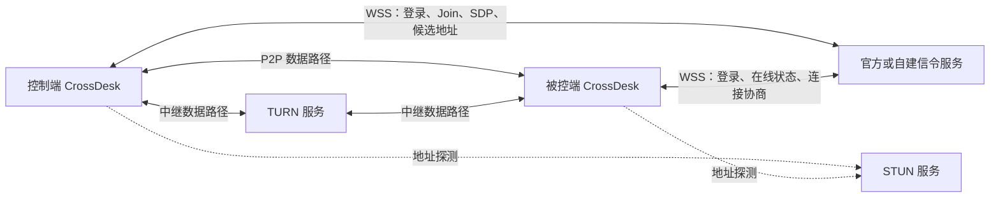
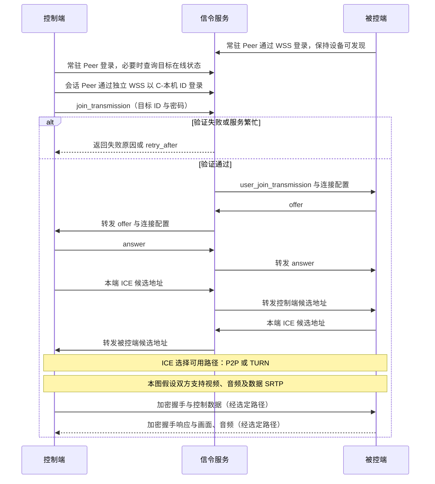
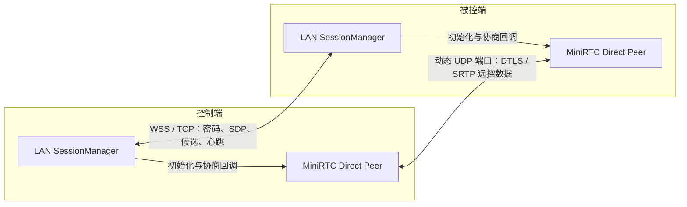
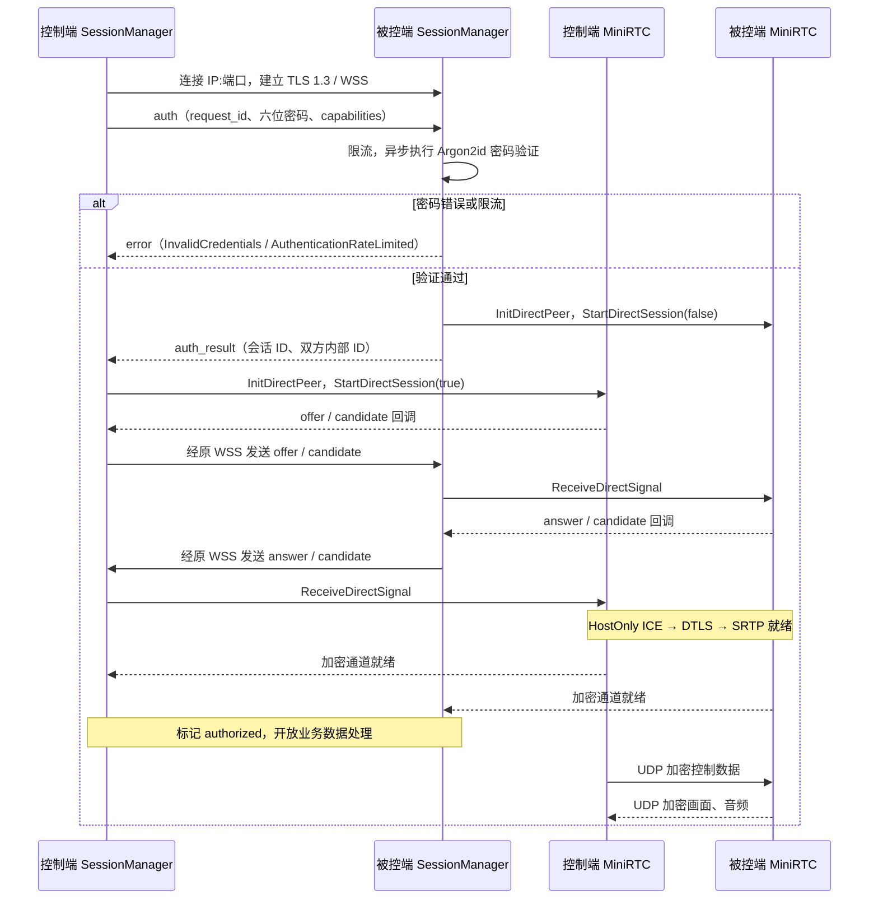
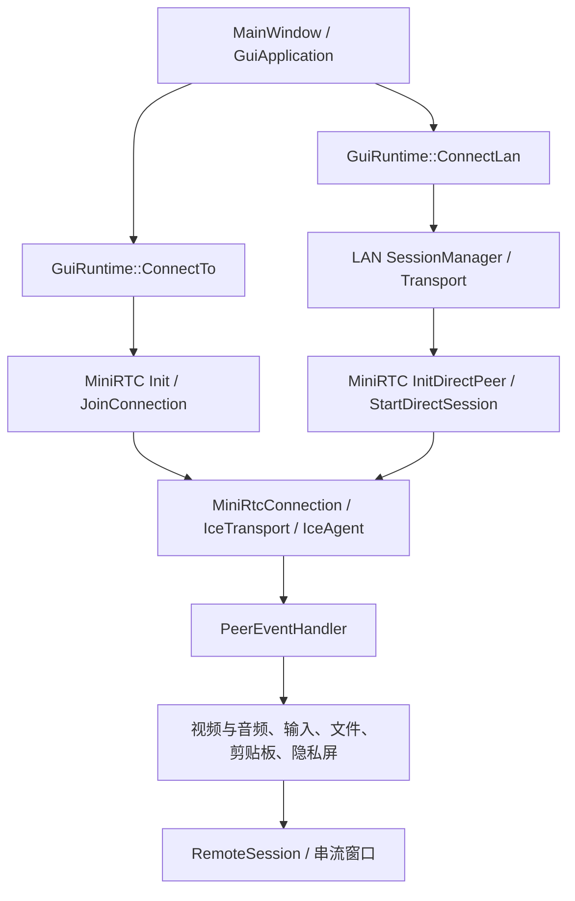

# ID 连接与 IP 直连架构

[项目首页](../README.md) · [使用指南](USER_GUIDE.md#quick-start) · [IP 直连操作](USER_GUIDE.md#lan-direct) · [GUI 架构](gui-architecture.md)

本文描述当前已实现的桌面客户端架构，代码依据为 CrossDesk `cc48eb65`、MiniRTC `040114d`，核对日期为 **2026-10-25**。ID 模式的服务端行为按客户端协议说明；服务端内部实现由独立的 CrossDesk Server 项目维护。

## 1. 两种模式的边界

两种模式复用桌面采集、编码、音视频传输、键鼠、文件和剪贴板处理。差别主要在**如何找到设备、在哪里验证密码，以及通过什么通道交换连接参数**。

“ID 连接”不等于“公网中继”：通过 ID 找到设备后，远控数据可以在局域网内直连，也可以经 NAT 穿透直连，必要时使用 TURN 中继。“IP 直连”仍有连接协商，只是协商消息直接在两台电脑之间交换。

| 项目 | ID 连接模式 | IP 直连模式 |
| --- | --- | --- |
| 用户输入 | 9 位设备 ID 和密码 | 数字 IPv4、可选端口和密码 |
| 设备寻址 | 信令服务维护的设备及在线状态 | 直接连接指定 `IP:端口` |
| 密码验证位置 | 控制端提交 Join，由信令服务返回验证结果 | 被控端在本机验证收到的密码 |
| 信令通道 | 双方连接官方或自建服务的 WSS | 控制端直接连接被控端的 WSS |
| ICE 策略 | `ManagedServers`，使用服务端下发的 ICE 配置 | `HostOnly`，限定本次 WSS 连接的双方 IPv4 |
| 数据路径 | P2P 直连，或按配置与网络条件使用 TURN | 双方 UDP 直连，无 TURN 回退 |
| 原生数据加密要求 | 按对端能力协商 SRTP，保留旧端兼容分支，见第 4.1 节 | 必须支持视频、音频及数据 SRTP，否则拒绝建立会话 |
| 外网要求 | 取决于信令及 STUN/TURN 服务部署位置 | 直连会话不依赖外网服务 |
| 本机端口 | 无需用户提供固定远控监听端口 | 每个本机 IP 独立保存 TCP 协商端口，首次优先 `52888` |
| 密码与近期记录 | ID 凭据与 `cloud_id` 记录 | 独立 LAN 凭据与 `lan_direct` 记录 |

以下流程图以原生桌面客户端互连为主。浏览器通过 ID 模式接入时，MiniRTC 使用 `DataChannelConnection` 适配 WebRTC；不能直接连接 LAN 的 WSS 协商入口来代替 Web 客户端协议。

## 2. ID 连接模式

### 2.1 网络拓扑

实线中的 P2P 与 TURN 表示可选择的数据路径，不表示每个会话同时使用两者。信令服务负责控制消息，TURN 负责中继数据；二者即使部署在同一台服务器上，也是不同职责。

### 2.2 建立连接

以下时序以双方支持视频、音频及数据 SRTP 的原生桌面客户端为例；旧端兼容行为见第 4.1 节。图中的“控制端”代表整个客户端进程，其常驻 Peer 和控制端会话 Peer 各自建立 WSS 连接。

1. `GuiRuntime::CreateConnectionPeer()` 创建本机的常驻 MiniRTC Peer，`Init()` 连接信令服务并登录。控制另一个设备时，`ConnectTo()` 创建或复用对应的 `RemoteSession` 和控制端 Peer；该会话 Peer 以 `C-<本机ID>` 作为登录身份，使用独立的信令连接。
2. 普通交互连接在需要时进行在线探测；桌面墙后台连接可以直接由 Join 结果判定可用性。没有密码时先在本地弹窗收集，不先发送一次空密码请求。
3. 当前桌面调用为 `JoinConnection(peer, "目标ID@密码")`，MiniRTC 将其放入 `join_transmission` 的 `transmission_id`，经 WSS 提交给信令服务。登录尚未完成时，Join 会等待登录结果。
4. 服务端的加入通知驱动被控端发起 offer，控制端回复 answer；双方通过服务端转发 ICE 候选。支持新版协议的服务端提供每次连接的 ICE 配置及有效期，客户端仍保留旧服务端兼容路径。
5. MiniRTC 根据中继设置、对端能力和网络条件选择直连或中继。数据不通过信令 WebSocket 搬运。当前桌面端始终请求 SRTP；原生 ID 会话仍允许第 4.1 节所述的旧端兼容行为，因此请求 SRTP 不代表所有数据最终都经过加密。

官方服务与自托管服务采用同一路径，区别是服务地址、证书信任和部署配置。两端必须接入同一服务。ID 登录状态和远控数据连接是分别管理的，信令存在重连与会话恢复处理，不能把每次信令重连都视为新建远控会话。

对应代码：[桌面连接流程](../apps/desktop/src/gui/runtime/connection_runtime.cpp)、[本机 Peer 初始化](../apps/desktop/src/gui/runtime/gui_runtime.cpp)、[MiniRTC 登录与 Join](../deps/submodules/minirtc/src/pc/peer_connection.cpp)、[信令 TLS 与重连](../deps/submodules/minirtc/src/ws/ws_client.cpp)。

## 3. IP 直连模式

### 3.1 网络拓扑与端口

用户填写的 `52888` 或自定义端口是**被控端 TCP 认证与协商入口**。视频、音频和业务数据使用 ICE 协商出来的 UDP 端口，不固定占用同一个 `52888`。仅放行协商 TCP 端口不足以保证远控数据能够通过防火墙。

LAN 协商通道使用 TLS 1.3、路径 `/crossdesk/lan/v2` 和 WebSocket 子协议 `crossdesk.lan.v2`。不需要部署中心信令服务，但每台启用该功能的电脑都会提供本机监听服务。应用原有 ID 模式的后台登录可能仍在运行；“IP 会话不依赖外网”不等于整个进程绝不访问外网。

### 3.2 初始化与多地址监听

`GuiRuntime::InitializeLan()` 在功能启用且运行宿主支持时创建 `lan::SessionManager`。管理器加载本地 LAN 身份、证书、密码和端口配置；尚无密码时先异步生成六位英文字母或数字密码，准备完成后开始接受连接。

- `LocalIpv4Interfaces()` 枚举已启用接口上的非回环单播 IPv4，包含 VPN 和虚拟接口；关闭所有接口监听后的独立监听模式使用 `physical_only` 筛选物理网卡。当前只接收数字 IPv4 地址，不解析主机名或 IPv6。
- 管理器约每 2 秒刷新接口快照。默认使用单个 `0.0.0.0` 监听，界面可选择包括 VPN 在内的实际 IPv4 分享；在“设置 → 常规 → 网络连接”中关闭“监听所有 IPv4 接口”并保存后，改为按物理网卡地址分别监听，界面也只列出这些地址。通配地址只用于绑定，不作为连接目标或 ICE 候选。
- 每个 IP 首次配置优先尝试 `52888`；无法绑定时请求操作系统分配端口，并在保持 socket 占用期间保存实际端口，避免“探测后释放、使用时被抢占”的竞争。
- 已保存的端口冲突时报告错误并重试原端口，不自动换号。手动改端口按“绑定新端口 → 保存配置 → 替换监听”的顺序执行，失败时保留原设置。
- “切换 IP”只改变显示和分享的地址。端口修改会停止旧端口接受新连接，但保留已经完成认证的会话及其他 IP 的监听。
- 网卡下线或 DHCP 换址导致本地 IP 从接口快照中消失时，管理器停止该地址的监听，并以 `InterfaceRemoved` 关闭使用该本地 IP 的已有会话。其他 IP 的监听继续运行；当前直连协议只允许一轮 ICE 协商，不支持会话内 ICE 重启或无缝迁移到另一张网卡，需要重新建立连接。
- 端口配置以 **IP 地址**为键，不跟随网卡标识。所有接口模式的端口单独保存在 `ports["0.0.0.0"]`，`listen_all` 保存模式，缺省为 `true`，已保存的 `false` 保留；设置页维护草稿，保存后应用，取消不改监听。切换不会覆盖各实际 IP 的端口。独立监听模式下，DHCP 分配未记录的新 IP 时，该地址重新执行“尝试 `52888` → 必要时分配可用端口”的首次配置流程；旧 IP 再次出现时沿用其保存的端口。

切换监听范围时先停止旧 acceptor，绑定目标监听并原子保存模式与新端口；失败时保留原设置并尝试重新绑定旧端口，恢复失败由后台维护继续重试并显示错误。已认证通道保留，未完成认证的通道关闭。所有接口模式在网卡增减时保持同一个监听，已有会话仍按其实际本地地址的存续状态处理。

这里的 LAN 策略限定候选地址，不通过“是否有外网”判断工作模式，也不只是检查地址是否属于某个私网网段。实际连接仍要求本次 WSS 连接使用的双方 IPv4 的 TCP 和 UDP 路径可达。

### 3.3 认证与协商时序

IP 直连由**控制端**发起 offer。双方内部 ID 和随机 `session_id` 用于本次会话路由，不需要用户填写设备 ID。协商消息带会话 ID 和严格递增序号；会话管理器检查状态顺序，再调用 `ReceiveDirectSignal()`。MiniRTC 进一步检查 SDP、候选数量、地址和 ICE 标识一致性，并去重候选。

SessionManager 将当前 WSS socket 的本地与对端 IPv4 传入 `InitDirectPeer()`，由 MiniRTC 构造 `HostOnly` 策略，启动独立 ICE worker，不执行云端登录。MiniRTC 通过 `SignalSender` 回调把协商消息交给 SessionManager，再由 WSS 发送。

MiniRTC 关闭 STUN/TURN 服务器访问、UPnP、ICE TCP 和公网打洞扩展，仅收集指定本机 IPv4 的 UDP host 候选。libnice 的 `direct-peer-address` 补丁同时检查远端候选和入站来源：在解析 STUN 连通性检查、学习新候选或回复数据之前，拒绝不匹配的 IP。ICE 自身的 STUN 检查报文仍会在双方之间使用，这与访问 STUN 服务器是两回事。

WSS 在连接成功后继续承担心跳和会话关闭消息。当前心跳约每 5 秒发送一次，等待响应超过 15 秒时关闭通道；WSS 关闭会驱动对应的 MiniRTC 会话清理。

对应代码：[LAN 传输层](../apps/desktop/src/network/lan/lan_transport.cpp)、[LAN 会话管理](../apps/desktop/src/network/lan/lan_session_manager.cpp)、[MiniRTC Direct Peer](../deps/submodules/minirtc/src/pc/direct_peer.cpp)、[候选策略](../deps/submodules/minirtc/src/ice/direct_ice_policy.h)、[libnice 补丁](../deps/submodules/minirtc/thirdparty/libnice/patches/direct_peer_0.1.24.patch)。

## 4. 密码、加密与身份的职责

### 4.1 ID 模式

客户端对信令服务建立 WSS，使用系统信任及平台 TLS 校验。登录身份按 Peer 的用途区分：

| 场景 | 登录身份及职责 |
| --- | --- |
| 本机常驻 Peer | 使用本机缓存身份；已有 ID 与密码时，普通登录提交 `本机ID@本机密码`，用于本机上线与接受远控 |
| 控制端会话 Peer | 以 `C-<本机ID>` 登录；目标设备的密码在后续 Join 中提交，不附加在该登录身份中 |
| 自托管首次身份分配 | 无缓存身份时，常驻 Peer 以空 `user_id` 请求服务端分配身份，不能假定首次登录时已经具备 ID 和密码 |

服务端支持重连令牌且客户端持有有效令牌时，后续登录可使用不带密码的 ID 与令牌；令牌被拒绝后可回退到原登录身份。连接目标设备时，控制端会话 Peer 将 `目标ID@目标密码` 放入 Join，由服务端返回成功、凭据错误、限流或繁忙结果。客户端解析结果并驱动密码弹窗与重试；服务端保存密码的具体方式及配额以配套服务端实现为准。

信令 TLS 与远控数据加密属于两条路径。原生远控的 DTLS 握手和 SRTP 处理位于 MiniRTC，不能把“信令使用 TLS”等同于“画面经 TLS WebSocket 传输”。

在 SDP 格式与能力字段校验通过的前提下，原生 ID 会话的 `NegotiateSrtp()` 保留以下兼容分支：

| 对端 SDP 能力 | 当前原生 ID 会话的处理 |
| --- | --- |
| 有 DTLS 指纹，且声明音频/数据 SRTP 能力 | 协商视频、音频及数据 SRTP，完成 DTLS 密钥交换后使用加密传输 |
| 有 DTLS 指纹，但未声明音频/数据 SRTP 能力 | 保留旧端兼容：视频使用 SRTP，音频和数据为明文 |
| 没有 DTLS 指纹 | 关闭该传输的 SRTP，允许进入兼容路径，不因缺少指纹直接按 IP 模式的规则拒绝连接 |

该表适用于 `MiniRtcConnection` 原生传输。浏览器使用 `DataChannelConnection` 的 WebRTC 适配路径，不按此表推断其加密行为。

对应代码：[常驻身份初始化](../apps/desktop/src/gui/runtime/gui_runtime.cpp)、[控制端会话登录与 Join](../apps/desktop/src/gui/runtime/connection_runtime.cpp)、[重连令牌](../deps/submodules/minirtc/src/pc/reconnect_login.h)、[SRTP 能力协商](../deps/submodules/minirtc/src/transport/ice_transport.cpp)。

### 4.2 IP 模式

IP 直连采用 **TLS 内提交密码，由被控端本地验证**：

- 密码为 6 位 ASCII 字母或数字，区分大小写。验证记录使用随机盐和 Argon2id，当前参数为 `m=19456 KiB, t=2, p=1`；不使用 SPAKE2+ 或额外的密码证明交换。
- 为支持主窗口显示和重启恢复密码，本地还保存 AES-256-GCM 加密的密码副本；密钥及凭据文件受本机用户权限保护。能读取该用户密钥和凭据文件的进程仍能恢复密码。
- LAN WSS 接受通过有效期、自签名及证书用途等基本检查的自签证书；不执行历史设备信任、TOFU、证书固定或设备身份确认。密码验证授权控制方访问被控端，本身不证明对方就是上次连接的设备。
- DTLS 仍核对本次 SDP 中协商的证书指纹。直连要求视频、音频及数据的 SRTP 能力成功协商，密钥导出和加密会话安装成功后才发送 `secure_ready`；桌面运行时随后设置 `authorized`，开放业务回调。

这意味着被动抓包不能直接读取 TLS 内的密码，但当前模型没有通过持久证书信任识别被冒充的被控端。当前会话的 DTLS 指纹校验也不提供这种历史身份保证。

认证限流分别按传输层来源 IP 和本机凭据目标计数，当前来源上限为 20 次失败、目标上限为 5 次失败。每个计数桶使用 **900 秒有效窗口**；未达到阈值时，窗口到期会清除旧的失败计数。某个桶达到阈值时，从该次验证失败完成的时刻重新计时，进入完整的 **900 秒冷却**，期间被拦截的请求不会延长冷却。任一维度处于冷却都会阻止密码验证。

并发验证先预留额度，避免同时请求绕过上限；另有每来源每分钟 60 次昂贵认证工作的准入限制。成功认证、重连或重复保存同一密码不会主动清空仍在有效窗口内的失败记录，跨窗口的旧失败次数不会永久累计。

**限流记录属于 SessionManager 的内存状态**，没有持久化到磁盘。退出程序或关闭功能并销毁管理器后，再创建管理器会获得新的限流状态；当前实现不提供跨重启的永久累计失败次数限制。

对应代码：[密码验证](../apps/desktop/src/network/lan/lan_password.cpp)、[本地身份和凭据存储](../apps/desktop/src/network/lan/lan_identity.cpp)、[认证限流](../apps/desktop/src/network/lan/lan_auth_limiter.cpp)、[DTLS/SRTP 就绪处理](../deps/submodules/minirtc/src/transport/ice_transport.cpp)。

## 5. 运行时复用、线程与关闭

图中的共享传输层针对原生桌面会话。ID 模式中的 WebRTC 客户端走独立适配实现，共用上层业务接口。

- **会话隔离：** ID 模式保留本机常驻 Peer 和控制端会话 Peer。每个 LAN 会话拥有独立 Direct Peer，内部使用 `lan/` 前缀的随机键，避免与设备 ID 冲突；`lan_controllers_` 管理被控方向的 LAN 会话。
- **业务复用：** `ControllerEvents()`、`WithController()` 等根据会话类型路由到正确 Peer。视频、音频、键鼠、文件、剪贴板仍交给原有回调和功能模块；采集设备按整体连接需求管理。
- **线程分工：** SessionManager 的公开操作和 `Tick()` 在 GUI 管理线程运行；Transport 使用一个共享 Asio 网络线程，回调仅提交有界事件。密码计算、Peer 准备与销毁在后台任务执行，MiniRTC 自身处理 ICE 和媒体工作。
- **数据放行：** LAN 业务回调检查会话授权和关闭状态。加密就绪通知与数据到达可能交错，少量早期控制消息会在有界队列中暂存，授权后按序处理；其他业务数据不因排队而提前获得授权。
- **关闭顺序：** 标记关闭并停止新回调，取消会话相关传输，关闭 WSS；后台排空已有回调，再执行 `CloseDirectSession()` 和 `DestroyPeer()`。网络回调中不直接销毁 Peer。
- **资源边界：** 当前管理器最多保留 24 个通道，未认证接入最多 16 个，异步密码验证与 Peer 准备各最多 2 个任务，同时准入的准备中/已认证会话最多 8 个。协商还设有消息数量、字节和阶段超时限制，防止无限队列或等待。

关闭 IP 功能时，运行时等待会话、密码任务、准备任务及清理任务全部结束，再释放 LAN 管理器和网络线程。快速关闭后重新开启会等待旧实例排空；应用退出时不会重新创建监听。

对应代码：[LAN 与桌面运行时的衔接](../apps/desktop/src/gui/runtime/lan_runtime.cpp)、[回调生命周期](../apps/desktop/src/gui/runtime/session_lifecycle.cpp)、[控制消息处理](../apps/desktop/src/gui/runtime/peer_data_callbacks.cpp)。

## 6. 配置、模式切换与近期记录

| 状态 | 含义与行为 |
| --- | --- |
| `connection_mode = id / ip` | 主窗口的连接入口、凭据展示和近期列表模式；切换后保存，下次启动恢复 |
| `enable_ip_direct = true / false` | IP 功能总开关，默认开启；控制 LAN 管理器及监听是否存在 |
| LAN 身份目录 | 位于应用配置目录的 `lan` 子目录，保存内部设备 ID、证书、密码及每 IP 的端口 |
| `cloud_id` 近期记录 | 保存 ID 设备及可选记住的密码，接入原有在线状态与分组流程 |
| `lan_direct` 近期记录 | 保存当前连接返回的内部设备 ID、最近 IP/端口及可选密码；与 ID 记录分别展示 |

主窗口切回 ID 模式不会停止 LAN 监听，也不自动断开已有 LAN 会话。取消“启用 IP 直连”并保存，才会断开 LAN 会话、释放监听端口、回到 ID 模式并隐藏模式按钮；已有 ID 会话继续运行。重新启用时恢复原有密码、端口及近期记录。

LAN 近期记录的设备 ID 用于归档，不用于确认对端身份。重连先使用记录中的 IP/端口；界面上的 `LAN` 标记表示连接类型，不代表服务器在线查询的结果。两种模式均可在不保存密码的情况下记录设备。

同一台被控电脑的不同 LAN IP 共用一份 LAN 密码，各地址的端口单独保存。密码热更新会终止使用旧凭据的未完成认证，已经授权的会话继续运行；后续连接需使用新密码。

对应代码：[全局配置](../apps/desktop/src/config_center/config_center.cpp)、[模式与界面绑定](../apps/desktop/src/gui/application/gui_application.cpp)、[近期记录存储](../apps/desktop/src/thumbnail/thumbnail.cpp)。

## 7. 支持范围与排查入口

IP 直连目前面向 Windows、macOS、Linux 的普通桌面客户端。浏览器、原生移动端、Windows 登录前服务和 Linux 无头控制台没有这条直连入口。数字 IPv4 和 UDP host 候选是当前实现约束。所有接口模式可接受 VPN 或虚拟网卡上的连接，控制端也允许通过这些接口发起连接，但仍要求双方 TCP、UDP 路径可达；不提供主机名解析、IPv6、回环远控或公网 NAT 穿透。

| 现象 | 首先检查的层 |
| --- | --- |
| ID 模式未连接服务器 | WSS 服务地址、TLS 信任、登录与重连状态 |
| ID 可查询但远控失败 | Join 返回的凭据/限流错误，以及 ICE 配置、直连或 TURN 路径 |
| IP 模式按钮未显示 | `enable_ip_direct` 设置是否开启并保存 |
| IP / 端口无法连接 | 对方实际显示的地址和端口、监听范围、TCP 监听及防火墙 |
| 密码通过但没有远控画面 | 双方 UDP 可达性、HostOnly 候选检查、DTLS/SRTP 就绪状态及采集权限 |
| 改端口后旧连接仍能使用 | 已认证会话保留原通道，这是端口热更新的预期行为 |
| 网卡下线或换 IP 后直连中断 | 原本地 IP 是否消失；关联会话会关闭，需使用当前可达的 IP/端口重新连接 |
| 切回 ID 模式仍有 LAN 监听 | 模式选择只改变入口；停止监听需要关闭 IP 功能总开关 |

使用步骤见 [IP 直连指南](USER_GUIDE.md#lan-direct)，自建信令服务见 [自托管说明](SELF_HOSTING.md)。本文记录当前架构，不替代 Windows/Linux、跨机器或长期会话的实际验证结果。
